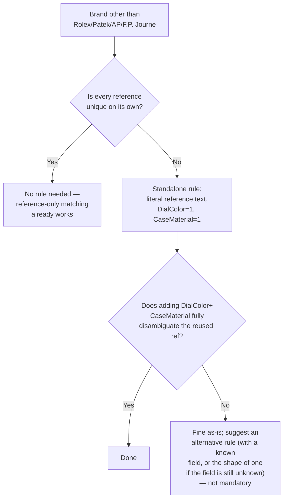
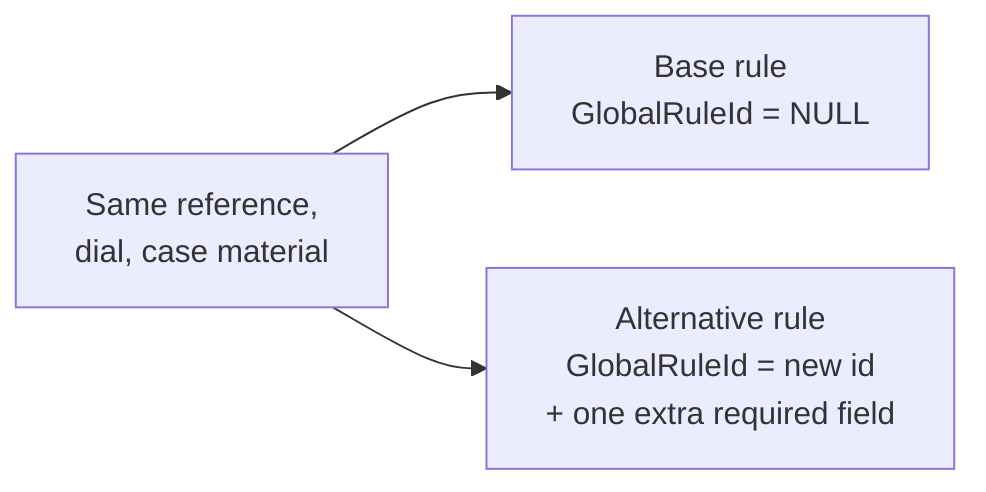

# Catalog enrichment rules — the complete guide

This is the **single entry point** for everything about EveryWatch enrichment rules: what they are, when to build one, how to build and update one, and how to handle genuine collisions. It consolidates and supersedes stitching together three separate documents — [Catalog-Enrichment-Rules-Documentation.md](Catalog-Enrichment-Rules-Documentation.md) (full SP/table reference), [Catalog-Enrichment-Multiple-Match-Disambiguation.md](Catalog-Enrichment-Multiple-Match-Disambiguation.md) (the collision problem), and [Catalog-Enrichment-PaulNewman-Tiffany-Variations.md](Catalog-Enrichment-PaulNewman-Tiffany-Variations.md) (named-variant precedent) — plus the decision framework worked out across a real multi-brand review (Toledano & Chan, Moritz Grossmann, Romain Gauthier, Speake-Marin, Laurent Ferrier, Hautlence, Behrens) that doesn't exist in any of those three docs.

**Those three docs are not deleted** — they remain for full SP-parameter-level detail. This guide is the practical, example-driven version; follow the links out when you need exact syntax for an edge case.

---

## 1. What is an enrichment rule, and why does it exist?

EveryWatch mostly matches an incoming watch listing to a canonical **enrichment** record using three fields: **Reference Number**, **Dial Color**, **Case Material** (`usp_AssignEnrichmentToWatches`, "core-fields" match type). That's cheap and reliable — but for some manufacturers, the reference number *itself* already encodes extra information. Rolex is the clearest example:

```
126710BLNR
└──┬───┘└┬┘
 model#  bezel/material code (BL=Blue, NR=Black)
```

Any watch with reference `126710BLNR` is guaranteed to have a blue/black bezel — you don't need to separately verify that against the watch's own scraped data. A **global enrichment rule** is a template, stored per manufacturer, that captures this: "any watch matching structure `XXXXXXAAAA` needs field Y checked; any watch matching the shorter structure `XXXXXX` needs fields Y **and** Z checked." One rule covers an entire family of references instead of hand-authoring one row per SKU — essential when a brand has hundreds or thousands of SKUs sharing a format.

**Where rules live:** `tbl_CAT_EnrichmentRule_d` (EWMaster / `MasterDB`), authored via `sp_create_enrichment_rule`. Full schema in [Catalog-Enrichment-Rules-Documentation.md §4](Catalog-Enrichment-Rules-Documentation.md#4-enrichment-rule-table-tbl_cat_enrichmentrule_d).

---

## 2. The core-fields matching problem & the collision backlog

The matcher can only use core fields if they're enough to pick **exactly one** enrichment. When two different enrichments share the identical `(Reference, DialColor, CaseMaterial)` triple, the matcher can't tell them apart — the watch sits unresolved in **`tbl_RE_DataToFix`**, EveryWatch's "multiple enrichment match" backlog table.

This shows up in reporting: `Queries/Ravi/Enrichment/Multiple Enrichment.sql` and `Queries/Ravi/Enrichment Count Improvenment/Missing ENR.sql` both surface this backlog by brand/reference. Any time you see a reference stuck with no enrichment assigned despite having reference/dial/case data, this is almost always why.

**The fix is either:**
- A **global rule** that requires an *additional* field to exist for the broader (parent-level) match — see §3, §5.
- An **alternative rule** when two enrichments genuinely share the exact same core-field triple on purpose — see §7.

---

## 3. Reference structure anatomy & the hierarchy concept

Rolex, Patek Philippe, and Audemars Piguet references can be abstracted into an `X`/`A` pattern (`X` = digit, `A` = letter, separators kept literal) via `fn_ConvertToStructure` (`ew-db/MasterDB/dbo/function/fn_ConvertToStructure.sql`) — a purely mechanical, manufacturer-agnostic function:

```sql
-- letter -> 'A', digit -> 'X', everything else unchanged
126710BLNR  ->  XXXXXXAAAA
```

**The hierarchy** comes from progressively stripping suffix precision. Worked example — Patek Philippe `3711/1G-001`:

```
Level 1 (Full):         3711/1G-001  →  XXXX/XA-XXX
Level 2 (Parent):       3711/1G      →  XXXX/XA
Level 3 (Grandparent):  3711/1       →  XXXX/X
Level 4 (Great-GP):     3711         →  XXXX
```

**The core principle: the less specific the match, the more fields must be required.** At the full level, the dash-suffix (`-001`) already pins the exact dial variant — often no extra field check is needed. Strip it (Level 2) and you lose that, so `DialColor` becomes required. Strip the material letter (`G`) too (Level 3/4) and now `CaseMaterial` must also be required, or a steel and a gold watch with the same bare model number would incorrectly share an enrichment.

Full mechanics (structure table, unique constraints, publish flow): [Catalog-Enrichment-Rules-Documentation.md §3–§5](Catalog-Enrichment-Rules-Documentation.md#3-reference-structure-hierarchy-tbl_cat_referencestructure_d).

---

## 3a. Model-based rules (F.P. Journe) — confirmed from live table data

Unlike Rolex/Patek/AP, **F.P. Journe rules aren't built on reference structure at all** — they're keyed directly off `ModelId`. This is confirmed by actually inspecting live exports of both tables (`Queries/Vishva/Results-referenceStructureTable.csv`, `Queries/Vishva/Results-enrichmentRuleTbl.csv`):

- F.P. Journe's `ManufacturerId` (53) has **zero rows** in `tbl_CAT_ReferenceStructure_d` — no reference-structure rows exist for it at all, in contrast to Rolex/Patek/AP (`ManufacturerId` 129/114/12 respectively — inferred by cross-referencing their stored `X`/`A` patterns against the known anatomies in §3), which have dozens of structure rows each.
- Every F.P. Journe row in `tbl_CAT_EnrichmentRule_d` has `EnrichmentStructureId = NULL` and `ParentStructureId = NULL`, with `ModelId` populated instead — exactly matching the table's own check constraint (`ModelId IS NOT NULL OR EnrichmentStructureId IS NOT NULL`).

**The pattern in practice:** each `ModelId` gets a **base rule** (`GlobalRuleId = NULL`) with a field-requirement combination tailored to that specific model — e.g. model `1785` requires `CaseMaterial` + `CaseSize` + `DialColor`; model `1944` requires `CaseMaterial` + `DialColor` + `StrapMaterials`. Unlike Rolex/Patek/AP's hierarchy (where required fields are determined by *how much structure precision was lost*), each F.P. Journe model's base requirement is set independently, model by model — there's no "strip a suffix, add a field" mechanic here.

**On top of that, many models also carry one or more alternative rules** (non-NULL `GlobalRuleId`) — and a `GlobalRuleId` is often **reused across many different models** that happen to need the same field combination, rather than minted fresh per variant. Confirmed example: `GlobalRuleId = 4` (`CaseMaterial=1, DialColor=1, CaseSize=1`) appears against 9 different models (`1837`, `1817`, `1781`, `1780`, `1819`, `1823`, `1822`, `860`, `869`) with an identical bit combination — but the same id also appears against model `877` with a *different* combination (`DialColor=1` only). Don't assume perfect uniformity even within one `GlobalRuleId` — always check the actual row, per §8's discipline.

**Practical implication for §5's create/update runbook:** for F.P. Journe (or any future model-based manufacturer), use `@ModelName` instead of `@ChildRefStructure`/`@PRefStructure` in `sp_create_enrichment_rule`, and `sp_Get_EnrRule_UpdateFormat`'s "FP Journe bulk" mode (`@ManufacturerName = N'FPJourne'`, `@ReferenceStructure` omitted) to review the full set of rules for a manufacturer at once — there's no hierarchy to navigate level by level.

---

## 4. Decision framework: should I build a rule for this reference/brand at all?

### 4.0 The system's actual default behavior — read this first

The matching engine's default behavior is **brand-tiered**, and this is the single most important fact for deciding whether a rule is needed:

- **Rolex, Patek Philippe, Audemars Piguet:** default core-fields check = Reference + DialColor + CaseMaterial (§1–§2).
- **F.P. Journe:** model-based, not reference-based at all (§3a).
- **Every other manufacturer: the default is Reference Number alone.** No DialColor/CaseMaterial check happens for these brands unless a rule is explicitly created for that reference.

**This applies to any brand** — not just small/independent ones. The goal isn't "does this look like a small watchmaker" — it's simply "is this one of the four specially-handled manufacturers (Rolex, Patek, AP, F.P. Journe) or not." Any brand outside those four, regardless of size or how mainstream it is, follows §4.1's test below. For the vast majority of such brands, the question "should I build a rule" is much simpler than reverse-engineering a Rolex-style structural encoding — it comes down to whether the bare reference number is already unique.

### 4.1 The primary test — use this for any brand other than Rolex/Patek/AP/F.P. Journe

1. **Normalize first** (see the collision-checking steps below), then check: **is every reference number, on its own, unique** across the brand's catalog (maps to exactly one enrichment)?
   - **Yes → no rule needed.** The default reference-only matching already works.
   - **No** — one or more references are shared by 2+ catalogs/enrichments — **→ create a standalone rule** for that specific reference requiring `DialColor = 1` + `CaseMaterial = 1`. This is a **single flat rule using the literal reference text** — no hierarchy, no masking (see §5's two use cases).
2. **After adding that requirement, check again:** does `(Reference, DialColor, CaseMaterial)` now uniquely resolve every row that shares the reference?
   - **Yes → done**, the standalone rule is sufficient.
   - **No** — some rows still share the identical triple. **This is not automatically a problem that must be fixed.** It's completely fine for a reference to sit with multiple catalogs sharing the same `(Reference, DialColor, CaseMaterial)` — nothing forces a resolution. Instead:
     - **If a genuinely distinguishing field is known** (dial material, edition, bracelet material, calibre, etc. — confirmed, never guessed, §8) — **suggest** an alternative rule using that field.
     - **If the available data doesn't contain a field that distinguishes them** — still **suggest** the *shape* of the rule that would resolve it (e.g. "once you identify what field separates these two, an alternative rule keyed on that field would work — here's the mechanism"), without insisting the user go find that field right now. The suggestion is the deliverable; acting on it is optional and up to the user.



### 4.2 The rarer, more ambitious case — promoting a brand to a Rolex/Patek/AP-style hierarchy

Occasionally a brand has enough volume and a genuinely decodable reference format that it's worth building a real tiered structure (masked text, `ParentId`-linked hierarchy) the way Rolex/Patek/AP work — covering many different literal references under one shared template, rather than one flat rule per reused reference. This is **rare** and a **separate, additional** consideration from §4.1 — most brands never need it. Only pursue this when **both** hold:

1. **The reference text genuinely encodes something**, verified by measuring how consistently a reference segment predicts `CaseMaterial`/`DialColor` **across multiple different model-number families** (within-family "consistency" is circular). Report the literal rate and every exception; never claim more than the measured rate.
2. **Genuine partial references actually exist in the catalog data** — a shorter form of a reference (stripping a trailing `.`/`-` segment) also appears independently elsewhere, repeating across multiple distinct model families, not just once.

If you find yourself here, re-read §4.1 first — in practice, the reused references this test would cover can usually just be handled as standalone rules (§4.1) one at a time, which is simpler and doesn't risk one masked rule accidentally covering more literal references than intended (see §5's masking-collision note).

### 4.3 For Rolex, Patek Philippe, Audemars Piguet, and F.P. Journe — check for an existing match **first**

§4.1/§4.2 are about deciding whether to build a rule that **doesn't exist yet**. For these four manufacturers, that's usually not the situation you're in — they already have mature, populated rule sets (dozens of structure rows each for Rolex/Patek/AP, ~150 rows for F.P. Journe, per the live-data export in §3a/§9). The far more common day-to-day case for a **new catalog entry** under one of these four is: **a matching structure and rule already exist — just assign it, don't create anything new.**

**The workflow:**

1. **Determine the new catalog's structure.** For Rolex/Patek/AP: convert its reference number through `fn_ConvertToStructure` (§3) to get the masked pattern. For F.P. Journe: use its `ModelId` directly (§3a — no structure conversion, it's model-based).
2. **Check whether that structure/model already has a rule.** Use `sp_Get_EnrRuleList` (§5's Step 1) to list existing rules for that manufacturer + structure (or manufacturer + model, for F.P. Journe):
   ```sql
   EXEC dbo.sp_Get_EnrRuleList @ManufacturerName = N'Rolex', @ReferenceStructure = N'XXXX';
   ```
3. **Compare the catalog's own populated fields against each returned rule variant's required-field pattern** (base rule = `GlobalRuleId IS NULL`, plus any alternative rows per §7). A rule "matches" when every field it requires is actually populated on this catalog (e.g., if a variant requires `Nickname=1`, the catalog needs a nickname populated to qualify for it).
4. **If a matching rule is found** — **tell the user to assign that rule's `GlobalRuleId` to the catalog's `RuleId`** (`tbl_CAT_Catalog_d.RuleId`). That's the entire action needed. **Do not create a new global or alternative rule** — one already exists and covers this catalog.
5. **If no existing rule variant's required fields match** — *then* it's a genuinely new case, and you fall back to the regular flow: either a brand-new structure needing §4.2/§5 Use Case A treatment, or an existing structure whose current rule(s) don't account for some field this catalog has populated, needing a new alternative rule (§7) with a new `GlobalRuleId`.

**Worked example (real data, from §7):** a new Rolex catalog comes in matching structure `XXXX` (id `44`). `sp_Get_EnrRuleList` shows two existing variants: `GlobalRuleId=19` (base: `CaseMaterial`+`DialColor`+`DialMaterial`) and `GlobalRuleId=34` (`CaseMaterial`+`DialColor`+`Nickname`). If the new catalog has a nickname populated, it matches the `GlobalRuleId=34` variant — assign `RuleId=34` to the catalog, done. If it doesn't have a nickname but does have dial material populated, it matches the base variant — assign `RuleId=19` (or leave `RuleId` NULL if that's how the base is conventionally represented — confirm against how existing catalogs for that structure are actually set). Either way, **no SQL rule-creation is needed** for this catalog.

**For any manufacturer other than these four** — skip this section entirely and go straight to §4.1/§4.2's regular flow, since there's no pre-existing structure/rule infrastructure to check against in the first place.

### How to check for collisions (do this first, always)

1. **Always check the actual live catalog data** (a `DataAddedToCatalog`-style export) — **never** an earlier raw/unreviewed "batch" spreadsheet. The batch sheets are pre-canonicalization working data with duplicate listing rows and an unresolved review flag; they will show noise that isn't a real matching problem.
2. **Normalize first, always:** `ref = ProposedRefNumber if non-empty else referencenumber`; `model = ProposedModelname if non-empty else modelname`; **drop any row with `ToDelete = TRUE`**. Skipping this step produces false collisions from data that's already been superseded or deleted.
3. **Group by `ref` alone first** (per §4.1 — this is the primary signal for non-R/P/A/F.P.Journe brands). Any reference used by more than one row needs at least a standalone rule. Then group by `(ref, dial, case)`: any group still sharing more than one distinct `enrichmentid` after adding dial/case is a genuine collision needing an alternative rule.
4. **Before concluding a collision needs a rule, check if it's just a data error.** Pull full row detail (catalogid, image, sourcelink) and eyeball it. Real examples from this review: a Toledano & Chan duplicate resolved by its own `ToDelete=TRUE` flag; a Laurent Ferrier collision where one row's reference (`LF116.01`) was simply mislabeled — the correct reference was `LCF036.AC-RAKE`. Always ask the person who owns the data before assuming a collision is a genuine variant.
5. **Only after confirming a collision is genuine** (both watches are real, correctly labeled, different products) does it become a candidate for an alternative rule — see §7.

### Worked example gallery — 7 real brands (verdicts corrected against §4.1's primary test)

| Brand | Reference format | Reused references? | Collisions after dial+case added | Verdict |
|---|---|---|---|---|
| Toledano & Chan | `B/1`, `B/1.2`, `B/1.3r` | **Yes** — `B/1` shared by 3 catalogs (different dials/case) | 1 (`B/1.2` duplicate, resolved via `ToDelete`) | 🔶 Standalone rule needed for `B/1` (DialColor+CaseMaterial fully disambiguates the remaining 3) |
| Moritz Grossmann | `MG-000001`, `MG-002071`... | No — every reference unique | 0 | ⛔ No rule |
| Romain Gauthier | `MON00001`, `MON00002`... | No — every reference unique | 0 | ⛔ No rule |
| Speake-Marin | `413807010`, `423811040`... | **Yes** — `594208010` shared by 2 catalogs (Blue vs. Gray dial) | 0 (dial alone already disambiguates) | 🔶 Standalone rule needed for `594208010` (DialColor required; a real material-encoding pattern also exists in this brand's numeric family — see §4.2 note — but no partial-reference hierarchy to build it on) |
| Laurent Ferrier | `LCF004.G1.RG1` → bare `LCF004` | **Yes** — 56/195 rows use bare model numbers, across 8 models | 4 confirmed genuine (kept unresolved) after fixing 2 data errors | 🔶 Standalone rules (literal text, one per reused bare reference: `LCF001`, `LCF004`, `LCF007`, `LCF013`, `LCF025`, `LCF036`, `LCF039`, `LCF044`) — **not** a masked hierarchy (see §5) |
| Hautlence | `HL02`, `HLQ07`, mixed formats | **Yes** — 10 references reused | 1 confirmed genuine (`HL02`) after fixing 9 others | 🔶 Standalone rules (9); `HL02` → alternative rule pending a distinguishing field |
| Behrens | `BHR030`, `BHR011C`... | Yes — some reuse | 5 groups, all confirmed genuine by image review | ⚠️ Needs the most manual triage; multiple alternative-rule candidates pending distinguishing fields |

The lesson from this table: **the primary question for any brand other than Rolex/Patek/AP/F.P. Journe is simply "is the reference reused?"** — not whether it encodes a Rolex-style pattern, and not whether the brand happens to be a small independent workshop or a larger mainstream name. These 7 examples all happen to be small/independent brands because that's what came up during this review, but §4.1's test applies identically to any manufacturer in that "everyone else" bucket. Moritz Grossmann and Romain Gauthier are the only two of these seven with zero reused references; everyone else needed at least a standalone rule somewhere. §4.2's tiered-hierarchy test is a separate, rarer question that didn't actually apply to any of these seven in practice — even Laurent Ferrier's real need turned out to be standalone rules, once §4.1's simpler test was applied correctly.

---

## 5. How to create a rule (step-by-step + SQL) — two use cases

There are two different situations, and they use the reference-structure text **differently**:

- **Use Case A — genuine structural rule (Rolex/Patek/AP only, in practice):** you deliberately want **one rule to cover many different literal references** that share a decodable shape. Here you pass the **masked** `X`/`A` pattern (confirmed from live data, §9), and can build a multi-tier hierarchy (leaf/parent/grandparent via `ParentId`).
- **Use Case B — standalone rule for one specific reused reference (the common case, per §4.1):** you found **one particular literal reference** is reused and want the system to require `DialColor`+`CaseMaterial` for **just that reference**, without broadening the match to anything else. Here you pass the **literal** reference text, and there's no hierarchy — a single flat rule.

Mixing these up is a real risk: masking a reference meant for Use Case B can accidentally make the rule match *other, unrelated* references that happen to share the same letter/digit shape (see the worked example below).

```mermaid
sequenceDiagram
    participant Op as You
    participant List as sp_Get_EnrRuleList
    participant Fmt as sp_Get_EnrRule_CreateFormat
    participant Create as sp_create_enrichment_rule
    participant Txn as sp_update_catalogTransaction
    participant Pub as Publish (sp_PublishAllDataNew)

    Op->>List: Confirm nothing already exists for this structure
    Op->>Fmt: Get a blank parameter template (optional)
    Op->>Create: Insert the rule row(s)
    Create->>Txn: Auto-bumps catalog TransactionID for matching rows
    Op->>Pub: Publish so _d rows promote to live tables
```

### Use Case B worked example — Laurent Ferrier's bare `LCF004` (the actual real-world case)

Per §4.1's corrected verdict: Laurent Ferrier's full/leaf references (`LCF004.G1.RG1`, etc.) are already unique on their own — no rule needed for those under reference-only default matching. Only the **bare model number** (`LCF004`), reused across multiple different watches, needs a rule. This is a **standalone rule using literal text**, not a masked hierarchy:

**Step 1 — check nothing exists:**
```sql
EXEC dbo.sp_Get_EnrRuleList @ManufacturerName = N'Laurent Ferrier', @ReferenceStructure = N'LCF004';
```

**Step 2 — create the rule** with the literal bare reference:
```sql
EXEC dbo.sp_create_enrichment_rule
    @ManufacturerName   = N'Laurent Ferrier',
    @ChildRefStructure  = N'LCF004',           -- literal text: only this exact reference is affected
    @DialColor          = 1,
    @CaseMaterial       = 1,
    @DialMaterial = 0, @CaseSize = 0, @StrapMaterials = 0, @Editions = 0, @DialStamp = 0,
    @Calibre = 0, @DialFinish = 0, @BezelColor = 0, @BraceletMaterial = 0, @BraceletStyle = 0,
    @IndicesEmbellishment = 0, @IndicesStyle = 0, @CaseEmblishment = 0, @DialEmblishment = 0,
    @Nickname = 0;
```

Repeat once per reused bare reference in this family: `LCF001`, `LCF004`, `LCF007`, `LCF013`, `LCF025`, `LCF036`, `LCF039`, `LCF044` — eight separate standalone rules, each targeting only its own literal string.

**Why not mask these?** If you masked `LCF004` to `AAAXXX` (Use Case A style), the rule would also match `LCF001`, `LCF007`, and every other "3 letters + 3 digits" Laurent Ferrier reference — accidentally broadening a fix meant for one specific reused reference into a rule affecting the whole family. Since these 8 references happen to need the *same* two fields anyway, that particular accident wouldn't cause visible harm here — but it's the wrong mechanism for the job, and would misbehave the moment one of those 8 needed a different field combination. Literal text keeps each rule scoped to exactly the reference it was built for.

### Use Case A worked example — a genuine Rolex/Patek/AP structural rule

```sql
EXEC dbo.sp_create_enrichment_rule
    @ManufacturerName   = N'Rolex',
    @ChildRefStructure  = N'XXXXXXAAAA',   -- masked pattern, e.g. covers 126710BLNR and siblings
    @DialColor          = 1,
    @DialMaterial = 0, @CaseMaterial = 0, @CaseSize = 0, @StrapMaterials = 0, @Editions = 0,
    @DialStamp = 0, @Calibre = 0, @DialFinish = 0, @BezelColor = 0, @BraceletMaterial = 0,
    @BraceletStyle = 0, @IndicesEmbellishment = 0, @IndicesStyle = 0, @CaseEmblishment = 0,
    @DialEmblishment = 0, @Nickname = 0,
    @PRefStructure      = N'XXXXXX',       -- parent tier: masked pattern, bare model number
    @PDialColor         = 1,
    @PCaseMaterial      = 1,               -- CaseMaterial required at parent — precision was lost
    @PDialMaterial = 0, @PCaseSize = 0, @PStrapMaterials = 0, @PEditions = 0, @PDialStamp = 0,
    @PCalibre = 0, @PDialFinish = 0, @PBezelColor = 0, @PBraceletMaterial = 0, @PBraceletStyle = 0,
    @PIndicesEmbellishment = 0, @PIndicesStyle = 0, @PCaseEmblishment = 0, @PDialEmblishment = 0,
    @PNickname = 0;
```

**Consequence of masking, worth remembering:** any other Rolex reference that happens to share the exact same letter/digit shape (`XXXXXXAAAA`) matches this same rule — that's the entire point in Use Case A (one rule, many SKUs), but it also means `tbl_CAT_ReferenceStructure_d`'s unique constraint `(ManufacturerId, ReferenceStructure, StatusId)` only allows **one** row per manufacturer per shape. Before creating a Use Case A rule, confirm the shape is unique enough within that manufacturer's real catalog that you're not accidentally lumping together references that actually need different field combinations.

**Step 3 (both use cases) — verify the catalog transaction bump** happened (the SP calls `sp_update_catalogTransaction` automatically) — check `tbl_CAT_Catalog_d.TransactionID` moved.

**Step 4 — publish** (`sp_PublishAllDataNew`) to promote `_d` rows to the live tables; `GlobalRuleSyncService` then syncs to EW.QL on its next run.

Full SP parameter reference, multi-tier (grandparent/great-grandparent) syntax, and duplicate-key handling: [Catalog-Enrichment-Rules-Documentation.md §10](Catalog-Enrichment-Rules-Documentation.md#10-sp_create_enrichment_rule--insert-rules).

---

## 6. How to update an existing rule

**Step 1 — generate an update script from the existing row:**
```sql
EXEC dbo.sp_Get_EnrRule_UpdateFormat
    @ManufacturerName = N'Rolex',
    @ReferenceStructure = N'126610LV',
    @GlobalRuleId = NULL;
```
This returns a pre-filled `EXEC dbo.sp_update_enrichment_rule` block — edit the bit flags you want to change, then run it.

**Step 2 — run the update:**
```sql
EXEC dbo.sp_update_enrichment_rule
    @EnrStructureId = 9876,
    @ManufacturerName = N'Rolex',
    @ChildRefStructure = N'126610LV',
    @DialMaterial = 1,   -- example: adding a new required field
    -- ...remaining bits unchanged from the generated block...
    @Nickname = 0;
```

**Note:** updating one tier's bits also syncs `TransactionId` to *other active rows sharing the same reference structure text* (or the same `ModelId` + `GlobalRuleId`) — this keeps sibling tiers in sync for publish. You don't need to update each tier separately for the transaction bump, only for the bit values you're actually changing.

Full parameter/locator reference: [Catalog-Enrichment-Rules-Documentation.md §11](Catalog-Enrichment-Rules-Documentation.md#11-sp_update_enrichment_rule--change-rule-bits).

---

## 7. Alternative rules — when two things genuinely collide on purpose

Sometimes two enrichments share the exact same `(Reference, DialColor, CaseMaterial)` triple **on purpose** — they're genuinely different real products, not a data error (confirmed per §4's collision-check process). A global rule can't fix this by adding more required core fields, since the triple is already identical. Instead: add a **second rule row** with the **same `EnrichmentStructureId`** but a **different `GlobalRuleId`**, with **one extra bit set** for whatever field actually distinguishes them.



**This mechanism does not require a broader structural family** — it works for a single standalone literal reference just as well as for a whole brand. Two examples:

**Named-variant precedent (Paul Newman, Rolex):** Rolex Daytona watches with a Paul Newman dial share their reference structure with the standard version, but carry a **Nickname**. Base rule: no `Nickname` requirement. Alternative rule: same structure, new `GlobalRuleId` (registered via `Tbl_cat_catalogCoreRules` — see [PaulNewman-Tiffany doc §6](Catalog-Enrichment-PaulNewman-Tiffany-Variations.md#6-tbl_cat_catalogcorerules--obtaining-globalruleid)), `Nickname = 1`.

**Generalized single-reference case (Hautlence `HL02`):** Two catalogs (`232012`, `232025`) both show reference `HL02`, dial Skeletonized, case Rose gold — confirmed genuinely different watches by image review, not a duplicate. Since `HL02` has no broader structural family (per §4's test, Hautlence fails the encoding half), the base rule is just the single-tier `HL02` rule from §5. The alternative rule would be: same `EnrichmentStructureId` (the registered `HL02` structure), new `GlobalRuleId`, plus whichever field is confirmed to actually distinguish catalog `232025` from `232012` — **this remains unresolved as of this writing**, because no field in the standard catalog CSV export (case size, bracelet material, calibre — none present) could confirm what that distinguishing field is. This is the canonical illustration of §8's rule.

**Confirmed in production** (from the same live `tbl_CAT_EnrichmentRule_d` export used in §3a): Rolex structure id `44` (masked pattern `XXXX`) has a base rule (`GlobalRuleId=19`: `CaseMaterial`+`DialColor`+`DialMaterial`) plus a separate row with `GlobalRuleId=34` adding `Nickname=1` — a real `Nickname=1` alternative rule, matching the Paul Newman pattern above. Separately, Patek structure id `38` (masked pattern `XXXX/XA`) carries a row with `GlobalRuleId=35` and `DialStamp=1` — a real `DialStamp=1` alternative rule, matching the Tiffany pattern. Both confirm the mechanism is genuinely in use, not just documented theory.

Registration steps (getting a `GlobalRuleId`, assigning catalog rows): [Catalog-Enrichment-PaulNewman-Tiffany-Variations.md §6–§7](Catalog-Enrichment-PaulNewman-Tiffany-Variations.md#6-tbl_cat_catalogcorerules--obtaining-globalruleid).

---

## 8. The one hard rule: never guess the distinguishing field

Across this whole review, the single most important discipline: **when two watches genuinely collide on core fields, do not invent a bit to set.** If the data available (catalog CSV, image, sourcelink) doesn't contain a field that actually separates them — case size, bracelet material, caliber, edition, anything — **say so explicitly and ask**, rather than picking a plausible-sounding bit. A wrong guess doesn't just fail to help — it actively mis-assigns future watches to the wrong enrichment. This is why the Hautlence `HL02` case (§7) is left unresolved rather than "solved" with a guessed field, and why Behrens' 5 confirmed collisions are held pending manual investigation rather than closed out.

---

## 9. Reference-structure text convention — resolved from live data

Earlier drafts of this guide flagged an apparent inconsistency: `sp_update_catalogTransaction` (§12.2 of the Rules doc) matches `@ReferenceStructures` tokens against `fn_ConvertToStructure(c.ReferenceNumber)` — implying the stored `ReferenceStructure` text is the **`X`/`A`-masked** form — yet every worked example throughout the docs passes **literal** reference text (`@ChildRefStructure = N'126610LV'`, not `N'XXXXXXAA'`). Both couldn't be simultaneously true as illustrated.

**This is now resolved — but only for genuine structural rules (§5's Use Case A).** Inspecting the live `tbl_CAT_ReferenceStructure_d` export (`Queries/Vishva/Results-referenceStructureTable.csv`) confirms every stored value for Rolex, Patek, and AP is the **masked pattern** — `XXXXXXAA`, `XXXX/XA-XXX`, `XXXXAA.AA.XXXXAA.XX`, etc. — **never** literal reference text like `126610LV`. The docs' own worked examples don't reflect what's actually stored.

**This does not mean every rule should use masked text.** As §5 explains, a **standalone rule for one specific reused reference** (Use Case B — the common case for any brand outside Rolex/Patek/AP) should use the **literal** reference text instead, precisely so it doesn't accidentally broaden to match other unrelated references sharing the same letter/digit shape. Laurent Ferrier's bare `LCF004` rule (§5) is the worked example of this — literal text is correct there, not masked.

**Note also that this table only covers structure-based manufacturers.** As confirmed in §3a, F.P. Journe has **zero** rows here — it's purely model-based, so the masked-vs-literal question doesn't even apply to it.

**When creating a genuine Use Case A structural rule**, run the literal reference text through the same conversion `fn_ConvertToStructure` performs (letter→`A`, digit→`X`, separators kept — see §3) before passing it to `@ChildRefStructure`/`@PRefStructure`/etc. Keep §5's masking-collision risk in mind: different literal references (even from different models) can share an identical mask, in which case they share one `tbl_CAT_ReferenceStructure_d` row — check the actual distinct masked shapes in your data rather than assuming one row per literal reference or per model. **For Use Case B (standalone rules), skip masking entirely and use the literal text.**

---

## 10. Troubleshooting

| Symptom | Likely cause |
|---|---|
| `Parent reference structure "%s" does not exist` | `@PRefStructure`/`@GPRefStructure` text not yet registered in `tbl_CAT_ReferenceStructure_d` for that manufacturer |
| `Ambiguous ReferenceStructure` | Duplicate structure names; need a parent tier or child-with-parent disambiguation |
| `Multiple active enrichment rules match the same natural key` | Tighten `GlobalRuleId`, parent structure, or model in the update batch |
| `RefStructure hierarchy does not match…` | Update batch's tier count doesn't match existing rows for that `@EnrStructureId` + `GlobalRuleId` |
| `Cannot sync catalog TransactionID: multiple distinct GlobalRuleId` | One EXEC call mixed different `@GlobalRuleId` values |
| Catalog not resyncing after a rule change | Publish wasn't run, or catalog `RuleId` ≠ rule `GlobalRuleId`, or a structure-text mismatch vs. `fn_ConvertToStructure` (see §9) |
| No transaction created | `sp_update_catalogTransaction` found zero matching catalog rows |
| A brand seems to need a rule but references look sequential/arbitrary | Re-run §4.1's simple reused-reference test first — this applies to any brand outside Rolex/Patek/AP/F.P. Journe, regardless of size; don't reach for §4.2's rarer structural test just because SKUs repeat |

---

## 11. Quick-reference appendix

**The 17 bit columns** (`tbl_CAT_EnrichmentRule_d`, all `BIT NOT NULL DEFAULT 0`):
`CaseMaterial`, `DialColor`, `DialMaterial`, `CaseSize`, `StrapMaterials`, `Editions`, `DialStamp`, `Calibre`, `DialFinish`, `BezelColor`, `BraceletMaterial`, `BraceletStyle`, `IndicesEmbellishment`, `IndicesStyle`, `CaseEmblishment`, `DialEmblishment`, `Nickname`

**Tier prefixes:** none = leaf/child, `P` = parent, `GP` = grandparent, `GGP` = great-grandparent (up to 4 levels).

**Key stored procedures:**
| Procedure | Role |
|---|---|
| `sp_Get_EnrRuleList` | List existing rules for a manufacturer/structure/model |
| `sp_Get_EnrRule_CreateFormat` | Emit a blank parameter template for `sp_create_enrichment_rule` |
| `sp_Get_EnrRule_UpdateFormat` | Emit a pre-filled `sp_update_enrichment_rule` block from an existing row |
| `sp_create_enrichment_rule` | Insert one or more rule rows (up to 4 tiers) |
| `sp_update_enrichment_rule` | Update bit flags / TransactionId on existing rows |
| `sp_update_catalogTransaction` | Bump catalog `TransactionID` for affected rows so publish/sync picks them up |

**File path index:**
| What | Where |
|---|---|
| Full rule mechanics (tables, all SPs, troubleshooting) | `Queries/Vishva/Catalog-Enrichment-Rules-Documentation.md` |
| Multiple-match/collision framing | `Queries/Vishva/Catalog-Enrichment-Multiple-Match-Disambiguation.md` |
| Named-variant alternative-rule precedent | `Queries/Vishva/Catalog-Enrichment-PaulNewman-Tiffany-Variations.md` |
| Reference-anatomy decoding process (Rolex/Patek/AP patterns) | `ew-brain/ew-brain/04-modules/enricher/global-rules/01-global-rule-creation-process.md` |
| `fn_ConvertToStructure` implementation | `ew-db/MasterDB/dbo/function/fn_ConvertToStructure.sql` |
| Live `tbl_CAT_ReferenceStructure_d` export (ground truth for §3a/§9) | `Queries/Vishva/Results-referenceStructureTable.csv` |
| Live `tbl_CAT_EnrichmentRule_d` export (ground truth for §3a/§7/§9) | `Queries/Vishva/Results-enrichmentRuleTbl.csv` |
| Multiple-enrichment backlog reports | `Queries/Ravi/Enrichment/Multiple Enrichment.sql`, `Queries/Ravi/Enrichment Count Improvenment/Missing ENR.sql` |
| Multi-match queue (runtime table) | `ew-db/EveryWatchDDL/dbo/table/tbl_RE_DataToFix` |
| Assignment engine (core-fields matching) | `ew-db/EveryWatchDDL/dbo/routine/usp_AssignEnrichmentToWatches.sql` |

---

## Document history

| Date | Notes |
|------|--------|
| 2026-09-10 | Initial consolidated guide — merges the 3 prior docs plus the decision framework and 7-brand worked-example gallery developed across a real multi-brand catalog review. |
| 2026-09-11 | Added §3a (F.P. Journe model-based rules) and corrected §5/§7/§9 after reviewing live `tbl_CAT_ReferenceStructure_d`/`tbl_CAT_EnrichmentRule_d` exports — confirmed `ReferenceStructure` is stored masked (not literal), confirmed F.P. Journe has zero reference-structure rows, corrected the Laurent Ferrier SQL example, and added two real confirmed alternative-rule examples (Rolex `Nickname=1`, Patek `DialStamp=1`). |
| 2026-09-11 (later) | **Major correction to §4**: the system's actual default matching behavior is Reference-only (not Reference+DialColor+CaseMaterial) for every brand except Rolex/Patek/AP/F.P. Journe — this replaces the old "encoding + partial reference" test as the primary decision criterion (demoted to §4.2, a rare/optional case) with a simpler "is the reference reused?" test (§4.1). Corrected the Toledano & Chan, Speake-Marin, and Laurent Ferrier verdicts in the brand gallery accordingly. Rewrote §5 to distinguish two use cases (masked/hierarchy for genuine Rolex/Patek/AP-style rules vs. literal/standalone for a reused reference in any other brand) and reverted the Laurent Ferrier example to literal text. Clarified throughout that this test applies to **any** brand outside the four specially-handled manufacturers, not just small/independent ones. |
| 2026-09-11 (final) | Softened §4.1 step 2: a genuine core-field collision (same reference+dial+case across catalogs) is **not** something that must be fixed — it's fine to leave as-is. The correct behavior is to **suggest** an alternative rule when a distinguishing field is confirmed, or suggest the general shape of what such a rule would look like when the field isn't known yet — never to insist on immediate resolution. |
| 2026-09-12 | Fixed a leftover inconsistency in §9: it still said "§5's Laurent Ferrier example has been corrected to use masked text," which was superseded when §5 was rewritten to use literal text for Laurent Ferrier (Use Case B). §9 now correctly distinguishes that masking applies only to genuine Use Case A structural rules, not standalone Use Case B rules. |
| 2026-09-12 (later) | Added §4.3: for Rolex/Patek/AP/F.P. Journe specifically, a new catalog entry should first be checked against **existing** structure/model + rule data (via `sp_Get_EnrRuleList`) — if a matching rule variant already exists, the answer is simply "assign that `GlobalRuleId` to the catalog's `RuleId`," with no new rule creation at all. §4.1/§4.2 (build a new rule) only apply when no existing match is found for these four, or as the regular flow for any other brand. |
