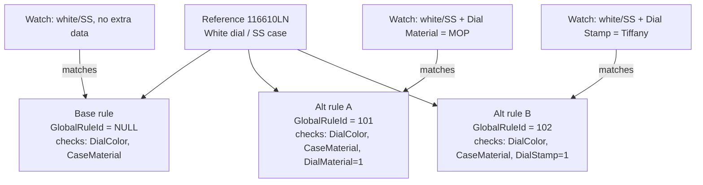

# Catalog enrichment rules — disambiguating watches with multiple enrichment matches

This document explains **why a reference number can match more than one enrichment**, and how we resolve that using **alternative global enrichment rules** (extra bit flags + a new `GlobalRuleId`) — the same mechanism described in [Catalog-Enrichment-Rules-Documentation.md](Catalog-Enrichment-Rules-Documentation.md) and applied to named variants in [Catalog-Enrichment-PaulNewman-Tiffany-Variations.md](Catalog-Enrichment-PaulNewman-Tiffany-Variations.md). This document generalizes that pattern beyond nickname/dial-stamp and ties it back to the **"multiple enrichment" backlog** (`tbl_RE_DataToFix`) that shows up in reporting.

**Database:** EWMaster (`ew-db/MasterDB`) for rule authoring; EveryWatch for runtime matching and the multi-match backlog.
**Primary audience:** engineers/editorial resolving watches stuck with `ReferenceEnrichmentId IS NULL` because more than one enrichment candidate exists for the same reference.

---

## 1. The problem

EveryWatch assigns a watch to an enrichment primarily using **core fields**: **reference number**, **dial color**, and **case material** (see `usp_AssignEnrichmentToWatches`, EnrichmentTypeId = 3 "Core-fields"). This is deliberately coarse — it is the cheapest, most reliable signal — but it means that **any two enrichments that share the same reference + dial color + case material are indistinguishable** to the matcher. When that happens, the watch has **multiple candidate matches** and gets logged to **`tbl_RE_DataToFix`** instead of being auto-assigned (see Ravi's `Multiple Enrichment.sql` / `Missing ENR.sql` reports, which surface exactly this backlog by brand and reference).

### 1.1 Worked example — Rolex reference (illustrative)

Suppose reference **116610LN** has three real-world variations that all share **white dial + stainless steel case**:

| # | Variant | Dial color | Case material | Extra distinguishing attribute |
|---|---------|------------|----------------|-------------------------------|
| 1 | Standard | White | Stainless steel | — (none) |
| 2 | Mother-of-pearl dial | White | Stainless steel | **Dial material** = Mother of Pearl |
| 3 | Tiffany-stamped dial | White | Stainless steel | **Dial stamp** = Tiffany & Co. |

Because core-field matching only checks reference + dial color + case material, **all three collapse onto the same signal** — EveryWatch cannot tell them apart, so a watch that is actually variant #2 or #3 sits unresolved in `tbl_RE_DataToFix` with multiple candidate enrichments instead of being auto-assigned to the correct one.

---

## 2. The fix — alternative rules with an extra discriminating field

We do **not** change the base rule. Instead we add **alternative enrichment rule rows** for the *same reference structure*, each requiring **one additional field to exist**, and give each variant its own **`GlobalRuleId`**:

| Rule | `GlobalRuleId` | Fields checked | Effect |
|------|----------------|-----------------|--------|
| Base rule | `NULL` (or base id) | DialColor, CaseMaterial | Matches variant #1 (and would match #2/#3 too if no alternative existed) |
| Alternative rule A | new id, e.g. `101` | DialColor, CaseMaterial, **DialMaterial = 1** | Only matches watches that also have Dial Material populated (MOP) → variant #2 |
| Alternative rule B | new id, e.g. `102` | DialColor, CaseMaterial, **DialStamp = 1** | Only matches watches that also have Dial Stamp populated (Tiffany) → variant #3 |

This is exactly the `tbl_CAT_EnrichmentRule_d` bit-flag mechanism from the main rules doc (§4) — the same **17 bit columns** (`CaseMaterial`, `DialColor`, `DialMaterial`, `DialStamp`, `Nickname`, …) that Paul Newman (`Nickname = 1`) and Tiffany (`DialStamp = 1`) use as *named* examples. Here the same pattern is used generically: **whichever field actually separates the variants** (dial material, dial stamp, edition, calibre, etc.) becomes the extra bit set to `1` on the alternative rule.

Once published, `GlobalRuleSyncService` turns each rule's bits into EWQL `EXISTS(...)` clauses (per §14 of the main rules doc), so the matcher requires the extra field to be **populated** before a watch qualifies for that variant's enrichment — resolving the ambiguity that put the watch into `tbl_RE_DataToFix`.

---

## 3. Step-by-step runbook

This reuses the procedures documented in full in [Catalog-Enrichment-Rules-Documentation.md](Catalog-Enrichment-Rules-Documentation.md) (§6–§12) and the registration step from [Catalog-Enrichment-PaulNewman-Tiffany-Variations.md](Catalog-Enrichment-PaulNewman-Tiffany-Variations.md) (§6).

| Step | Action |
|------|--------|
| 1 | **Identify the conflict** — use Ravi's `Missing ENR.sql` / `Multiple Enrichment.sql` (Queries/Ravi) to find references with an open `tbl_RE_DataToFix` backlog; inspect the candidate enrichment rows to see what actually differs between them (dial material, dial stamp, edition, etc.). |
| 2 | **List the existing (base) rule** — `EXEC sp_Get_EnrRuleList @ManufacturerName, @ReferenceStructure` to see current bit flags for that structure. |
| 3 | **Register a new `GlobalRuleId`** per variant — `INSERT INTO Tbl_cat_catalogCoreRules (...)`, read back `SCOPE_IDENTITY()`. One id per distinguishing attribute (one for the MOP variant, a separate one for the Tiffany variant). |
| 4 | **Create the alternative rule** — `EXEC sp_create_enrichment_rule` with the **same reference structure / parent tiers** as the base rule, the base bits copied over, **plus the one extra bit set to 1** (`@DialMaterial = 1` for variant A, `@DialStamp = 1` for variant B). |
| 5 | **Assign catalog rows** — set `tbl_CAT_Catalog_d.RuleId = @GlobalRuleId` for the catalog rows that represent each variant (matched by whatever identifies them in catalog — dial material lookup, dial stamp lookup, etc.). |
| 6 | **Publish** — `sp_PublishAllDataNew` promotes `_d` rows to `tbl_CAT_EnrichmentRule` / `tbl_CAT_Catalog`. |
| 7 | **Downstream sync** — `CatalogToEnrichmentSyncJob` → `GlobalRuleSyncService` refreshes EW.QL; affected watches get `EnrichChangeDate = NULL` and are re-matched by `usp_AssignEnrichmentToWatches`. |
| 8 | **Verify** — re-run `Missing ENR.sql` / check `tbl_RE_DataToFix` for the reference; the backlog for that reference should clear as watches now resolve to the correct variant enrichment instead of sitting as "multiple match". |

---

## 4. Choosing the discriminating field

Not every multi-match case is nickname or dial stamp — pick whichever bit actually separates the variants for that reference:

| If the variants differ by… | Set this bit to `1` on the alternative rule |
|------------------------------|----------------------------------------------|
| Special nickname (e.g. Paul Newman) | `Nickname` |
| Dial stamp / retailer signature (e.g. Tiffany, Trucchi, Serpico) | `DialStamp` |
| Dial material (e.g. Mother of Pearl vs. standard) | `DialMaterial` |
| Case size | `CaseSize` |
| Bracelet/strap material | `StrapMaterials` / `BraceletMaterial` |
| Edition | `Editions` |
| Calibre/movement | `Calibre` |
| Bezel color | `BezelColor` |
| Indices style/embellishment | `IndicesStyle` / `IndicesEmbellishment` |
| Case/dial embellishment | `CaseEmblishment` / `DialEmblishment` |

Only add the **minimum** extra bit(s) needed to separate the variant from the base — keep the rest of the tier's bits identical to the base rule so the shared facets (dial color, case material, etc.) still apply.

---

## 5. Related documentation

| Resource | Path |
|----------|------|
| Global enrichment rules — full mechanics, SPs, tables | [Catalog-Enrichment-Rules-Documentation.md](Catalog-Enrichment-Rules-Documentation.md) |
| Named-variant precedent (Paul Newman / Tiffany / 2499 & 1517 stamps) | [Catalog-Enrichment-PaulNewman-Tiffany-Variations.md](Catalog-Enrichment-PaulNewman-Tiffany-Variations.md) |
| Multiple-enrichment backlog reporting | `Queries/Ravi/Enrichment/Multiple Enrichment.sql`, `Queries/Ravi/Enrichment Count Improvenment/Missing ENR.sql` |
| Multi-match queue (runtime table) | `ew-db/EveryWatchDDL/dbo/table/tbl_RE_DataToFix` (referenced by the reports above) |
| Assignment engine (core-fields matching) | `ew-db/EveryWatchDDL/dbo/routine/usp_AssignEnrichmentToWatches.sql` |

---

## 6. Document history

| Date | Notes |
|------|--------|
| 2026-09-06 | Initial documentation — generalized the alternative-rule pattern (previously described only for Nickname/DialStamp) to the broader "multiple enrichment match" problem, using a worked Rolex 116610LN example (dial material / dial stamp as discriminators). |
