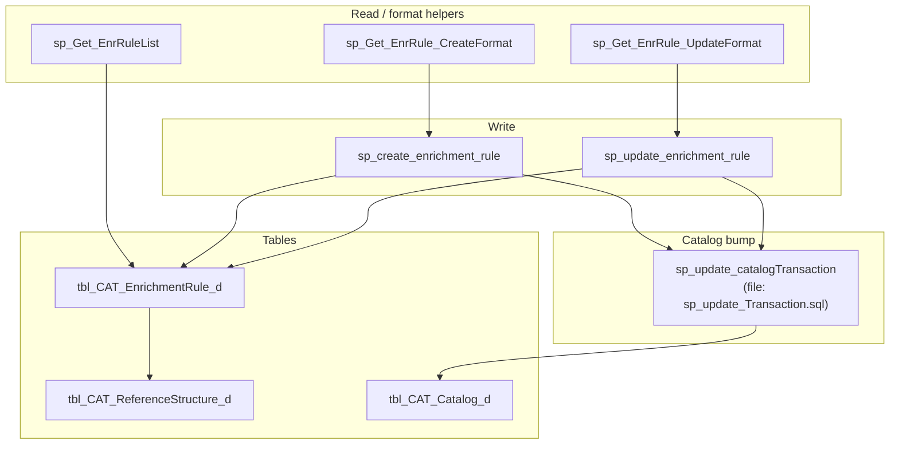
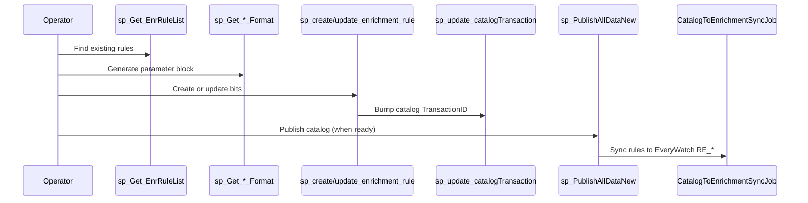

# Catalog enrichment rules (EWMaster) — documentation

This document describes **global enrichment rules** maintained in **EWMaster** (`MasterDB`): where they came from, how they are stored, how the maintenance stored procedures work, and how catalog `TransactionID` updates tie rule changes to catalog resync. It is written as a **handover / runbook**, in the same style as [Catalog-WatchTo-CaseDimension-Migration-Log.md](Catalog-WatchTo-CaseDimension-Migration-Log.md).

**Database:** EWMaster (`ew-db/MasterDB`)  
**Primary audience:** engineers and editorial staff who create or change enrichment rules for **Rolex**, **Patek Philippe**, **Audemars Piguet** (reference-structure brands), and **F.P. Journe** (model-based rules).

---

## 1. Background: from Google Sheet to database

### 1.1 What lived in the sheet

Historically, **global enrichment rules** for Rolex, Patek, and AP were maintained in a **Google Sheet**. For each **reference number structure** (and its **parent / child hierarchy** in the reference tree), the sheet recorded **which watch attributes must be present** when that structure matches — for example:

- Dial color  
- Case material  
- Dial material  
- Case size  
- Strap / bracelet materials  
- Edition, dial stamp, calibre  
- Bezel color, bracelet style  
- Indices style / embellishment  
- Case / dial embellishment  
- Nickname  

Those “check this field” flags are **not** literal values in the sheet; they mean “when a watch hits this rule, **require** this attribute to exist” (in the runtime pipeline this becomes EWQL `EXISTS(...)` clauses — see §8).

### 1.2 Why we moved to SQL

The sheet was hard to version, validate, and connect to **catalog** rows. The migration introduced:

1. **`tbl_CAT_ReferenceStructure_d`** — canonical reference-structure strings per manufacturer, with **parent/child** links.  
2. **`tbl_CAT_EnrichmentRule_d`** — one row per rule variant: structure (or model), optional parent structure, optional **`GlobalRuleId`**, and **17 bit columns** for the attributes above.  
3. **Stored procedures** to list, create, update, and generate parameter blocks for rules.  
4. **`sp_update_catalogTransaction`** (script file: `sp_update_Transaction.sql`) — after a rule change, bump **`TransactionID`** on affected **`tbl_CAT_Catalog_d`** rows so publish/sync picks them up.

Sheet data was **bulk-loaded** into these tables; day-to-day maintenance uses the SPs below.

---

## 2. What is a “catalog enrichment rule”?

In EWMaster, a row in **`tbl_CAT_EnrichmentRule_d`** is a **template** for how watches under a given **reference structure** (or **model**, for F.P. Journe) should be split into enrichments. It does **not** store EWQL text in SQL — it stores:

| Concept | Storage |
|--------|---------|
| **Who** (brand) | `ManufacturerId` → `tbl_CAT_Manufacturer_d` |
| **Which reference “level”** | `EnrichmentStructureId` + optional `ParentStructureId` → `tbl_CAT_ReferenceStructure_d` |
| **Or which model** (FP Journe) | `ModelId` → `tbl_CAT_Model_d` (structure columns NULL) |
| **Rule variant** | `GlobalRuleId` (nullable; groups different field-combination templates for the same structure) |
| **Which fields to require** | 17 `bit` columns (`CaseMaterial`, `DialColor`, …) — `1` = check this field, `0` = do not |
| **Change tracking** | `TransactionId`, `CreatedDate`, `StatusId` |

**Runtime (EveryWatch):** `GlobalRuleSyncService` (ew-scheduler) reads published **`tbl_CAT_EnrichmentRule`** + **`tbl_CAT_ReferenceStructure`**, builds EWQL into **`tbl_RE_EnrichmentRule`** where `ReferenceEnrichmentId IS NULL`, then refreshes the EW.QL rule cache. See `ew-brain/03-architecture/enrichment-lifecycle.md` (Phase 1b).

**Catalog link:** `tbl_CAT_Catalog.RuleId` corresponds to **`GlobalRuleId`** on the rule row. When rules change, catalog rows with matching reference structures (and `RuleId`) get a new **`TransactionID`** so **`CatalogToEnrichmentSyncJob`** treats them as out of date.

---

## 3. Reference structure hierarchy (`tbl_CAT_ReferenceStructure_d`)

### 3.1 Table shape

| Column | Purpose |
|--------|---------|
| `RefStructureId` | Surrogate PK (identity) |
| `ManufacturerId` | Brand |
| `ReferenceStructure` | Normalized structure string (e.g. from `fn_ConvertToStructure(ReferenceNumber)`) |
| `ParentId` | Self-FK to parent `RefStructureId` (NULL = root-level node for that string) |
| `TransactionId`, `StatusId`, `CreatedDate` | Standard catalog draft metadata |

**Unique constraint (draft):** `(ManufacturerId, ReferenceStructure, StatusId)`.

Published table **`tbl_CAT_ReferenceStructure`** mirrors draft rows when `TransactionId` advances (via **`sp_PublishAllDataNew`**).

### 3.2 How rules use the hierarchy

For Rolex / Patek / AP, one **logical** reference family often has **multiple enrichment rule rows** at different tree levels:

| Tier (SP parameter prefix) | Meaning | Typical `ParentStructureId` |
|----------------------------|---------|-----------------------------|
| **Child** (leaf) | `@ChildRefStructure` / `@ReferenceStructure` | NULL or explicit parent |
| **P** (parent) | `@PRefStructure` | Parent of leaf |
| **GP** (grandparent) | `@GPRefStructure` | Ancestor |
| **GGP** (great-grandparent) | `@GGPRefStructure` | Ancestor |

Each tier can have **different bit flags** (e.g. leaf checks dial color + case material; parent tier checks dial color only). The **create/update** procedures can insert or update **up to four rows in one call** when all tier bit sets are supplied.

**Resolution rules (summary):**

- Parent structure text must exist in `tbl_CAT_ReferenceStructure_d` for the manufacturer (`StatusId = 1`).  
- Leaf structure is matched with parent link when `@PRefStructure` / hierarchy is provided; ambiguous duplicate names are rejected.  
- For deep tiers (`GP` / `GGP`), the SP walks `ParentId` chains to ensure the supplied parent name matches the real tree.

---

## 4. Enrichment rule table (`tbl_CAT_EnrichmentRule_d`)

### 4.1 Table shape

| Column | Purpose |
|--------|---------|
| `Id` | Surrogate PK (identity) |
| `TransactionId` | Tied to `tblTransaction`; publish compares draft vs published |
| `CreatedDate` | Row creation time |
| `GlobalRuleId` | Optional variant id (from catalog `RuleId` / sheet “rule group”) |
| `ManufacturerId` | Brand |
| `EnrichmentStructureId` | FK → leaf (or matched) `RefStructureId` |
| `ParentStructureId` | FK → parent structure for this rule row (nullable) |
| `ModelId` | Used for model-based brands (e.g. F.P. Journe); structure FKs NULL |
| `StatusId` | `1` = active (maintained by SPs); `3` = delete on publish |

**Bit columns (all `NOT NULL`, default `0`):**

`CaseMaterial`, `DialColor`, `DialMaterial`, `CaseSize`, `StrapMaterials`, `Editions`, `DialStamp`, `Calibre`, `DialFinish`, `BezelColor`, `BraceletMaterial`, `BraceletStyle`, `IndicesEmbellishment`, `IndicesStyle`, `CaseEmblishment`, `DialEmblishment`, `Nickname`

**Constraints:**

- **`CK_tbl_CAT_EnrichmentRule_d_ModelOrStructure`:** `ModelId IS NOT NULL OR EnrichmentStructureId IS NOT NULL`  
- **`UQ_tbl_CAT_EnrichmentRule_d_EnrStruct_Mfr_GlobalRule`:** unique on `(EnrichmentStructureId, ParentStructureId, ManufacturerId, GlobalRuleId, ModelId)` — prevents duplicate active variants for the same natural key.

Published table **`tbl_CAT_EnrichmentRule`** has the same columns (no `StatusId` on publish table in script; lifecycle is driven from `_d`).

### 4.2 `GlobalRuleId`

Multiple rule rows can share the same **reference structure text** but differ in **which bits are set** (e.g. dial color only vs dial color + dial material). `GlobalRuleId` distinguishes those templates.

- **`NULL`:** original / default variant for that structure+parent+manufacturer.  
- **Non-NULL:** additional variant; catalog rows with `RuleId = <GlobalRuleId>` use that template.

Create/update SPs enforce **one distinct `GlobalRuleId` per batch** when syncing catalog transactions.

---

## 5. Draft vs published tables

| Draft (`*_d`) | Published | Sync |
|---------------|-----------|------|
| `tbl_CAT_ReferenceStructure_d` | `tbl_CAT_ReferenceStructure` | `sp_PublishAllDataNew` (MERGE / INSERT / DELETE by `TransactionId`, `StatusId`) |
| `tbl_CAT_EnrichmentRule_d` | `tbl_CAT_EnrichmentRule` | Same |

Rule maintenance SPs **only write `_d`**. Publishing promotes changes to non-`_d` tables for scheduler/EW.QL consumption.

---

## 6. Stored procedures — overview



| Procedure | File | Role |
|-----------|------|------|
| `sp_Get_EnrRuleList` | `sp_get_enrRuleList.sql` | Search/list rules (structure mode or model mode) |
| `sp_Get_EnrRule_CreateFormat` | `sp_get_EnrRule_createFormat.sql` | Emit blank `sp_create_enrichment_rule` parameter block |
| `sp_Get_EnrRule_UpdateFormat` | `sp_get_enrRule_updateFormat.sql` | Emit `sp_update_enrichment_rule` EXEC block from existing row(s) |
| `sp_create_enrichment_rule` | `sp_create_enrichment_rule.sql` | Insert one or more rule rows (multi-tier) |
| `sp_update_enrichment_rule` | `sp_update_enrichment_rule.sql` | Update bit flags / transaction on matched row(s) |
| `sp_update_catalogTransaction` | `sp_update_Transaction.sql` | Set `tbl_CAT_Catalog_d.TransactionID` for affected catalogs |

**Note on naming:** The transaction procedure is implemented as **`dbo.sp_update_catalogTransaction`**. The repo file is named **`sp_update_Transaction.sql`**; create/update rule SPs call `sp_update_catalogTransaction`, not a separate object named `sp_update_Transaction`.

---

## 7. `sp_Get_EnrRuleList` — list rules

**Purpose:** Return active enrichment rules with human-readable manufacturer, structure, parent, and model names.

### 7.1 Structure mode (Rolex / Patek / AP)

**Required:**

- `@ManufacturerName`  
- `@ReferenceStructure`  

**Optional filters:**

- `@ParentReferenceStructure`  
- `@ModelName` / `@ModelId`  
- `@GlobalRuleId`  

Resolves `EnrichmentStructureId` by matching `ReferenceStructure` text under the manufacturer.

### 7.2 Model mode (e.g. F.P. Journe)

**Supply one of:**

- `@ModelId`  
- `@ManufacturerName` + `@ModelName`  

Optional: `@GlobalRuleId`.

### 7.3 Result columns

`Id`, `TransactionId`, `CreatedDate`, `GlobalRuleId`, `ManufacturerName`, `ReferenceStructure`, `ParentReferenceStructure`, `ModelName`, `StatusId`, and all 17 bit columns.

**Example:**

```sql
EXEC dbo.sp_Get_EnrRuleList
    @ManufacturerName = N'Rolex',
    @ReferenceStructure = N'126610LV',
    @GlobalRuleId = 19;
```

---

## 8. `sp_Get_EnrRule_CreateFormat` — starter template for create

**Purpose:** Returns a single column `ParameterBlock`: a copy-paste skeleton for **`sp_create_enrichment_rule`**.

- Header: `@TransactionId`, `@ManufacturerName`, `@GlobalRuleId`, `@ModelName`  
- Four hierarchy lines: `@ChildRefStructure`, `@PRefStructure`, `@GPRefStructure`, `@GGPRefStructure`  
- Per tier, all 17 bit parameters default to `0` (`@CaseMaterial`, `@PDialColor`, `@GPDialColor`, …)

**Optional:** `@IncludeComments = 1` adds a short header comment.

**Example:**

```sql
EXEC dbo.sp_Get_EnrRule_CreateFormat @IncludeComments = 1;
-- Copy ParameterBlock from result grid, set NULLs to real values, execute.
```

---

## 9. `sp_Get_EnrRule_UpdateFormat` — starter template for update

**Purpose:** Build an **`EXEC dbo.sp_update_enrichment_rule`** script pre-filled from existing data.

### 9.1 Locators (pick one strategy)

| Strategy | Parameters |
|----------|------------|
| By rule id | `@Id` (+ optional `@GlobalRuleId` for NULL-safe match) |
| By structure | `@ManufacturerName`, `@ReferenceStructure`, optional `@ParentReferenceStructure`, `@ModelName`, `@GlobalRuleId` |
| By model | `@ModelId` or `@ModelName` |
| FP Journe bulk | `@ManufacturerName = N'FPJourne'`, omit `@ReferenceStructure` → all rules for manufacturer (special case) |

### 9.2 Output shapes

- **Single row:** one line with `@TransactionId`, `@GlobalRuleId`, `@ManufacturerName`, `@EnrStructureId`, `@ReferenceStructure`, `@ParentReferenceStructure`, `@ModelName`, `@StatusId`, and all bits.  
- **Multi-tier (same leaf structure):** shared header + multiple lines with `@ChildRefStructure` / `@PRefStructure` / … and tier-prefixed bits (`@P…`, `@GP…`).  
- **FP Journe multi-model:** one full parameter set per rule row (flat format).

If multiple rows match and `@ModelName` is used without `@Id`, the procedure **narrows to one row** (`ROW_NUMBER = 1`) to avoid accidental mass-edit scripts.

**Example:**

```sql
EXEC dbo.sp_Get_EnrRule_UpdateFormat
    @ManufacturerName = N'Rolex',
    @ReferenceStructure = N'126610LV',
    @GlobalRuleId = NULL;
```

---

## 10. `sp_create_enrichment_rule` — insert rules

**Purpose:** Insert one to four rows into **`tbl_CAT_EnrichmentRule_d`** from a **single scalar parameter list** (no table-valued parameter).

### 10.1 Required inputs

- `@ManufacturerName`  
- At least one of: `@ReferenceStructure`, `@ChildRefStructure`, `@ModelName`  
- At least one **complete tier** of bit flags: all 17 parameters for base and/or `@P…`, `@GP…`, `@GGP…` must be non-NULL for that tier to be inserted  

`StatusId` is fixed to **active (`1`)** inside the procedure.

### 10.2 Multi-tier create

When `@PRefStructure` / `@GPRefStructure` / `@GGPRefStructure` are used:

- Each tier must have **all** `@P…` / `@GP…` / `@GGP…` bits set, or that tier is skipped.  
- `@ChildRefStructure` and `@ReferenceStructure` must agree when both are passed.  
- Duplicate natural keys (same structure + parent + `GlobalRuleId`) → **skip insert** for structure rows; model rows → **error** if duplicate.

### 10.3 Outputs

`SELECT Id AS NewEnrichmentRuleId` for inserted rows.

### 10.4 Catalog transaction sync (post-insert)

Calls **`sp_update_catalogTransaction`**:

1. Builds comma-separated **reference structure** list from leaf + parent strings in the batch.  
2. Passes `@TransactionID` (from parameter or batch), `@RuleId = @GlobalRuleId`.  
3. If no reference text (model-only batch), uses **`@ModelId`** path instead.

**Guards:** Multiple distinct `GlobalRuleId` values in one batch → error; multiple `ModelId` in model-only sync → error.

### 10.5 Example (single leaf tier)

```sql
EXEC dbo.sp_create_enrichment_rule
    @TransactionId = NULL,          -- SP may pass through; catalog SP can create new txn
    @ManufacturerName = N'Rolex',
    @GlobalRuleId = 19,
    @ChildRefStructure = N'126610LV',
    @CaseMaterial = 1,
    @DialColor = 1,
    @DialMaterial = 1,
    @CaseSize = 0,
    @StrapMaterials = 0,
    @Editions = 0,
    @DialStamp = 0,
    @Calibre = 0,
    @DialFinish = 0,
    @BezelColor = 0,
    @BraceletMaterial = 0,
    @BraceletStyle = 0,
    @IndicesEmbellishment = 0,
    @IndicesStyle = 0,
    @CaseEmblishment = 0,
    @DialEmblishment = 0,
    @Nickname = 0;
```

---

## 11. `sp_update_enrichment_rule` — change rule bits

**Purpose:** Update **bit columns** and **`TransactionId`** on existing rule row(s). Does **not** change `EnrichmentStructureId` / `ParentStructureId` / `ModelId` unless resolved via natural-key matching (structure text in batch).

### 11.1 Locators

Same ideas as update format: `@Id`, or `@ManufacturerName` + `@ChildRefStructure` (+ parent tiers), or model-based batch.

**`@EnrStructureId`:** When set, enforces that all updated rows belong to that structure and that **hierarchy tiers** match existing rule count (cannot add/remove levels arbitrarily).

### 11.2 What gets updated

- Per matched `Id`: all 17 bits + `TransactionId` from batch.  
- **Sibling rules:** Other active rows with the **same** reference structure text (or same `ModelId` + `GlobalRuleId`) also get the **same** `TransactionId` (keeps tiers in sync for publish).

### 11.3 Catalog transaction sync

Same as create: **`sp_update_catalogTransaction`** with reference CSV and/or model path. Update SP includes **resolved** structure names from `#resolved` when building the CSV.

### 11.4 Example workflow

```sql
-- 1) Generate script
EXEC dbo.sp_Get_EnrRule_UpdateFormat
    @Id = 12345,
    @GlobalRuleId = 19;

-- 2) Edit bits in copied EXEC block, then run, e.g.:
EXEC dbo.sp_update_enrichment_rule
    @TransactionId = NULL,
    @EnrStructureId = 9876,
    @ManufacturerName = N'Rolex',
    @GlobalRuleId = 19,
    @ChildRefStructure = N'126610LV',
    @CaseMaterial = 1,
    @DialColor = 1,
    /* … remaining bits … */
    @Nickname = 0;
```

---

## 12. `sp_update_catalogTransaction` — why catalog `TransactionID` changes

**File:** `MasterDB/dbo/stored procedures/sp_update_Transaction.sql`  
**Object name:** `dbo.sp_update_catalogTransaction`

### 12.1 Why it exists

Changing a global rule changes how **catalog** rows should generate enrichments in EveryWatch. Catalog sync keys off **`tbl_CAT_Catalog.TransactionID`** vs **`tbl_RE_ReferenceEnrichment.CatalogTransactionId`**. Bumping catalog **`TransactionID`** marks those catalog rows **dirty** for:

- Publish (`sp_PublishAllDataNew` → `#EnrichmentCatalogPublish` → `sp_create_EnrichmentRefName`)  
- **`CatalogToEnrichmentSyncJob`** / `usp_CatToEnrichmentResync` (after publish to runtime DB)

Rule create/update SPs call this automatically; you can also call it standalone when needed.

### 12.2 Parameters

| Parameter | Behavior |
|-----------|----------|
| `@ReferenceStructures` | Comma-separated list; each token compared to `fn_ConvertToStructure(c.ReferenceNumber)` on `tbl_CAT_Catalog_d` |
| `@ModelId` | Alternative to structures (F.P. Journe–style); **mutually exclusive** with non-empty `@ReferenceStructures` |
| `@TransactionID` | If NULL, inserts **`tblTransaction`** (type **2** = update) and uses `SCOPE_IDENTITY()` |
| `@RuleId` | NULL → only catalogs with `RuleId IS NULL`; non-NULL → match that `RuleId` |
| `@IgnoreRuleIdFilter` | `1` → update all matching structures/models regardless of `RuleId` |

### 12.3 Matching logic

Updates **`tbl_CAT_Catalog_d.TransactionID`** for rows where:

- Reference structure ∈ split list **or** `ModelId = @ModelId`, **and**  
- `RuleId` matches per rules above.

Returns `CatalogId`, `TransactionID` for updated rows. If **no** catalog matches, returns without creating a transaction (when `@TransactionID` was NULL).

### 12.4 Standalone example

```sql
EXEC dbo.sp_update_catalogTransaction
    @ReferenceStructures = N'126610LV,126610LN',
    @TransactionID = NULL,
    @RuleId = 19;
```

---

## 13. End-to-end operator workflow



| Step | Action |
|------|--------|
| 1 | **List** — `sp_Get_EnrRuleList` with manufacturer + structure or model |
| 2 | **Format** — `sp_Get_EnrRule_CreateFormat` (new) or `sp_Get_EnrRule_UpdateFormat` (edit) |
| 3 | **Edit** — Set bits to `1` for fields that must be checked for that tier |
| 4 | **Execute** — `sp_create_enrichment_rule` or `sp_update_enrichment_rule` |
| 5 | **Verify** — Catalog `TransactionID` updated (output from nested `sp_update_catalogTransaction` or query `tbl_CAT_Catalog_d`) |
| 6 | **Publish** — Run normal catalog publish so `_d` → published tables |
| 7 | **Downstream** — Scheduler syncs global rules to EveryWatch and reprocesses affected watches (see enrichment lifecycle doc) |

---

## 14. Bit columns → runtime EWQL (EveryWatch)

After publish, **`GlobalRuleSyncService`** maps catalog bits to EWQL `EXISTS(...)` fragments:

| Catalog column | EWQL field (exists check) |
|----------------|---------------------------|
| CaseMaterial | caseMaterialIds |
| DialColor | dialColorIds |
| DialMaterial | dialMaterialIds |
| CaseSize | caseSizeId |
| StrapMaterials | braceletMaterialIds |
| Editions | edition |
| DialStamp | dialStamp |
| Calibre | caliberId |
| DialFinish | dialFinishIds |
| BezelColor | bezelColorIds |
| BraceletMaterial | braceletMaterialIds |
| BraceletStyle | braceletStyleIds |
| IndicesEmbellishment | indicesEmbellishmentIds |
| IndicesStyle | indicesStyleIds |
| CaseEmblishment | caseEmbellishmentIds |
| DialEmblishment | dialEmbellishmentIds |
| Nickname | nickNameId |

Structure-based rules also OR together clauses per hierarchy level (`referenceStructure`, `parentReferenceStructure`, `grandParentReferenceStructure`, `greatGrandParentReferenceStructure`). Model-based rules (F.P. Journe) use `modelName` + `EXISTS(modelId)` instead.

---

## 15. Related repo objects (quick index)

| Object | Path |
|--------|------|
| `tbl_CAT_EnrichmentRule_d` | `ew-db/MasterDB/dbo/table/tbl_CAT_EnrichmentRule_d.sql` |
| `tbl_CAT_EnrichmentRule` | `ew-db/MasterDB/dbo/table/tbl_CAT_EnrichmentRule.sql` |
| `tbl_CAT_ReferenceStructure_d` | `ew-db/MasterDB/dbo/table/tbl_CAT_ReferenceStructure_d.sql` |
| `tbl_CAT_ReferenceStructure` | `ew-db/MasterDB/dbo/table/tbl_CAT_ReferenceStructure.sql` |
| `sp_Get_EnrRuleList` | `ew-db/MasterDB/dbo/stored procedures/sp_get_enrRuleList.sql` |
| `sp_Get_EnrRule_CreateFormat` | `ew-db/MasterDB/dbo/stored procedures/sp_get_EnrRule_createFormat.sql` |
| `sp_Get_EnrRule_UpdateFormat` | `ew-db/MasterDB/dbo/stored procedures/sp_get_enrRule_updateFormat.sql` |
| `sp_create_enrichment_rule` | `ew-db/MasterDB/dbo/stored procedures/sp_create_enrichment_rule.sql` |
| `sp_update_enrichment_rule` | `ew-db/MasterDB/dbo/stored procedures/sp_update_enrichment_rule.sql` |
| `sp_update_catalogTransaction` | `ew-db/MasterDB/dbo/stored procedures/sp_update_Transaction.sql` |
| `fn_ConvertToStructure` | `ew-db/MasterDB/dbo/function/fn_ConvertToStructure.sql` |
| Publish enrichment rules | `ew-db/MasterDB/dbo/stored procedures/sp_PublishAllDataNew.sql` |
| Enrichment lifecycle (runtime) | `ew-brain/ew-brain/03-architecture/enrichment-lifecycle.md` |

---

## 16. Troubleshooting

| Symptom | Likely cause |
|---------|----------------|
| `Parent reference structure "%s" does not exist` | `@PRefStructure` / `@GPRefStructure` text not in `tbl_CAT_ReferenceStructure_d` for manufacturer |
| `Ambiguous ReferenceStructure` | Duplicate structure names; need parent tier or child-with-parent disambiguation |
| `Multiple active enrichment rules match the same natural key` | Tighten `GlobalRuleId`, parent structure, or model in update batch |
| `RefStructure hierarchy does not match…` | Update batch tier count ≠ existing rules for `@EnrStructureId` + `GlobalRuleId` |
| `Cannot sync catalog TransactionID: multiple distinct GlobalRuleId` | One EXEC mixed different `@GlobalRuleId` values |
| Catalog not resyncing after rule change | Publish not run, or `RuleId` on catalog ≠ rule `GlobalRuleId`, or structure mask mismatch vs `fn_ConvertToStructure` |
| No transaction created | `sp_update_catalogTransaction` found zero matching catalog rows |

---

## 17. Document history

| Date | Notes |
|------|--------|
| 2026-05-22 | Initial documentation from team workflow (sheet → DB → maintenance SPs → catalog transaction bump) and ew-db source review |
