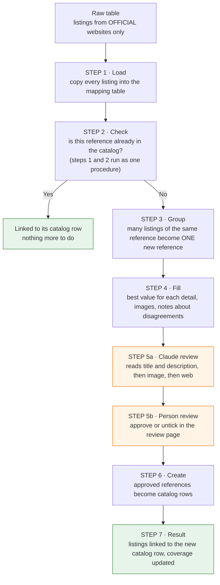
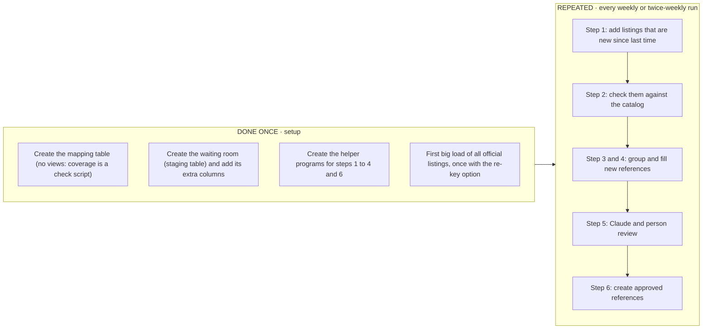
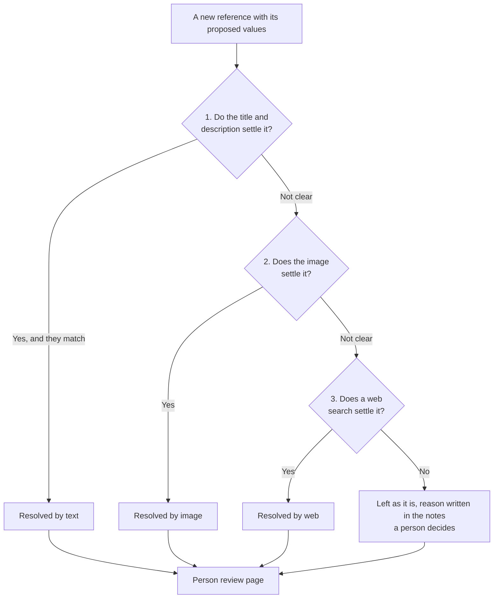
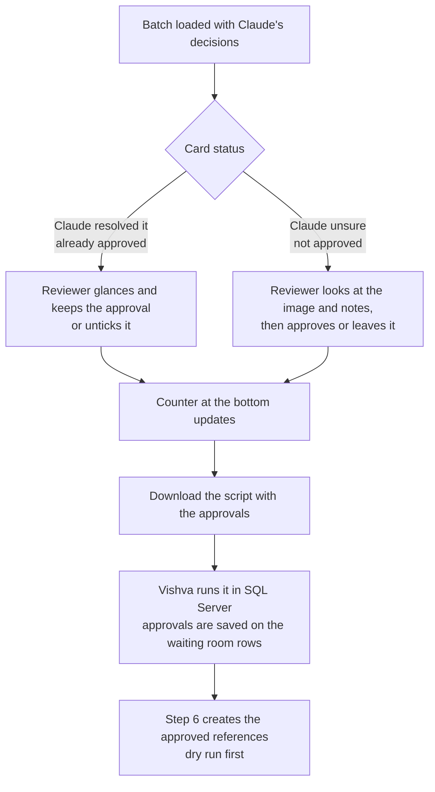
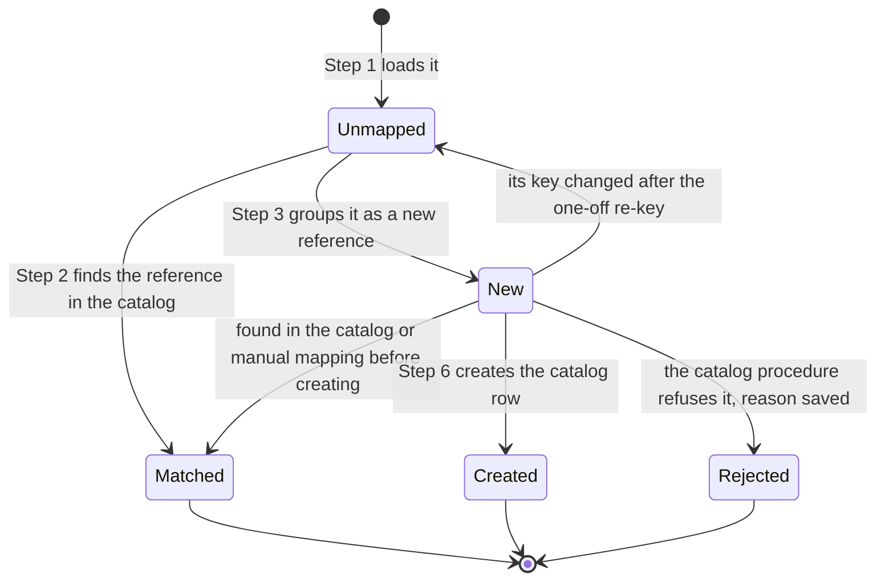
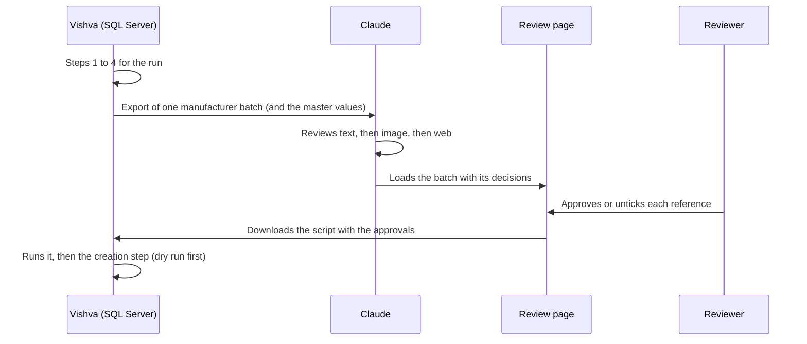

# Adding new watch references to the catalog (ECH-693)

*Plain-language overview. Status as of 4 Nov 2026. Detailed requirements: [RawToCatalog_NewRefs_Requirements.md](RawToCatalog_NewRefs_Requirements.md). Scripts: `Queries/Vishva/RawToCatalog_NewRefs/`. The technical object list is at the end (section 11).*

---

## 1. In one minute

**The problem.** Our crawler collects watch listings from many websites into a big "raw" table. The **official manufacturer websites** often show watch references (model numbers) that are **not yet in our catalog**. Today someone adds them **by hand**.

**What we are building.** A repeatable flow, run weekly or twice a week, that:

1. finds the references on official websites that the catalog does not have yet,
2. collects the best details for each one (model, colours, materials, size, images…),
3. has them **checked** by Claude and then by a person,
4. adds the approved ones to the catalog, **one catalog row per reference**.

**Second result.** A table that links every raw listing to its catalog row, so we can say "X% of official listings are already in the catalog".

> **Words used in this document**
> - **Raw row** = one listing the crawler found (one watch on one website).
> - **Reference** = the watch's reference/model number, for example `EW 4500-B`.
> - **Catalog row** = one watch reference in our real catalog.
> - **Staging** = a waiting room where each new reference sits until it is checked and approved.
> - **Master value** = an official allowed value in our system, for example the colour "Blue" (not "blu", not "Navy-ish").

---

## 2. The big picture



Orange boxes are the two checking steps. **Nothing reaches the catalog without them.**

---

## 3. One worked example

Imagine a made-up brand, **Example Watch Co.** The crawler found these listings on its official sites:

| Raw row | Website | Reference as written | Model | Dial colour | Case material |
|---|---|---|---|---|---|
| 101 | Official site, US | `EW 4500-B` | Marine | Blue | Steel |
| 102 | Official site, UK | `EW4500B` | Marine | Blue | Stainless steel |
| 103 | Official site, DE | `EW-4500-B` | Marine Diver | Blue | Steel |
| 104 | Official site, US | `EW 9100-K` | Marine | Black | Steel |

And the catalog already contains one row: `EW 9100-K`.

**What the flow does with it**

| Step | What happens | Result for the example |
|---|---|---|
| 1 Load | All four listings are copied into the mapping table | 4 rows, none linked yet |
| 2 Check | References are compared **ignoring spaces, dashes and capitals** | Row 104 matches the catalog (`EW 9100-K`), so it is linked. Rows 101–103 all read as `EW4500B` and match nothing |
| 3 Group | The three unmatched listings are one watch | **One** new reference, `EW 4500-B`, backed by 3 listings |
| 4 Fill | For each detail the most common value wins. Model: "Marine" appears twice and "Marine Diver" once, so **Marine** is chosen. The disagreement is written in a note. "Stainless steel" is turned into the official value **Steel**. Images and the source link are taken from the listings | A complete proposal with the note "Model differs: Marine ×2, Marine Diver ×1" |
| 5a Claude review | Claude reads the title and description of the three listings. If they say "Marine, 41 mm, blue dial", it agrees with **Marine** and approves. If they don't settle it, Claude looks at the image, then searches the web. If it is still unsure, it leaves a note | Approved by Claude, basis "text" |
| 5b Person review | A person opens the review page, sees the proposal, the note, the image and Claude's decision, and keeps or removes the approval | Approved |
| 6 Create | The catalog row for `EW 4500-B` is created through the standard catalog procedure | New catalog row |
| 7 Result | Listings 101, 102 and 103 are all linked to that new catalog row | 4 of 4 listings now linked |

---

## 4. Setup once, and what repeats

A common question: *"Do we create the mapping table every time?"* **No. It is created one time only.** After that, every run only **adds new rows** to it and **updates** existing ones.



| Item | Done once | Repeats every run |
|---|---|---|
| Mapping table, staging table (and its extra columns) | Created once | Only filled and updated |
| Helper programs (stored procedures) | Created once; re-created only if we change their logic | Just run |
| First load of all official listings | Once (about 5,000 listings were new in the first run) | Later runs add only listings that are new |
| Matching to the catalog | The first run covers everything | Each run checks only listings not yet linked |
| Staging of new references | The first batch (1,593 references) is the biggest | Later batches are much smaller |
| Review and creation | — | Every run, for the new references only |
| One-off clean-up after we changed the rules | Done when needed: the re-key run of the load step and the clean-up script `02b` (after adding the manual-mapping check, the Mirror fallback and the Rolex `ArtworkId` repair) | Not repeated |

A reference that was already created, is waiting for review, or was rejected is **never processed twice**.

### 4A. The order to run the scripts

All scripts are run by hand in SQL Server Management Studio, on EWMaster.

**One time**

| # | Script / command | Notes |
|---|---|---|
| 1 | `01_Create_RawRefMap_Table.sql` | Already done |
| 2 | `02_Create_SyncAndMatch_Procedure.sql` | Creates `sp_CAT_RawRef_SyncAndMatch` |
| 3 | `03_Create_Staging_Table_And_StageNew_Procedure.sql`, then `03b_Add_Review_Fields_To_Staging.sql` | 03b adds the 13 extra staging columns |
| 4 | `04a_Create_MapValue_Procedure.sql`, `04_Create_FillValues_Procedure.sql`, `06_Create_CreateCatalog_Procedure.sql` | Create the procedures (no data change) |
| 5 | `EXEC dbo.sp_CAT_RawRef_SyncAndMatch @Rekey = 1;` | Loads new rows and keys the old ones again with the current rules |
| 6 | `EXEC dbo.sp_CAT_RawRef_StageNew;` | |
| 7 | `02b_Clean_Staging_After_MappingTable_Check.sql` | List first, delete after it is confirmed |
| 8 | `EXEC dbo.sp_CAT_RawRef_FillValues @Reprocess = 1;` | Fills the new fields on references staged earlier |
| 9 | `05c_Export_Master_Values_For_Review.sql` | Master values for the review fields (not needed with read-only database access for Claude) |
| 10 | `DROP` of the old procedures and views | The old numbered procedure names and the two views |

**Every run (weekly or twice a week)**

| Step | Script / command |
|---|---|
| 1 | `EXEC dbo.sp_CAT_RawRef_SyncAndMatch;` |
| 2 | `EXEC dbo.sp_CAT_RawRef_StageNew;` |
| 3 | `EXEC dbo.sp_CAT_RawRef_FillValues;` |
| 4 | `05b_Export_Review_Batch.sql` for one manufacturer, then Claude reviews and builds the review page |
| 5 | Run the approvals script downloaded from the review page |
| 6 | `EXEC dbo.sp_CAT_RawRef_CreateCatalog @ManufacturerName = N'...', @MaxRows = 5;` (dry run, the default), then without `@MaxRows` |
| 7 | The same with `@IsDryRun = 0` (real run) |
| 8 | `Check_Step6_Results.sql` |

---

## 5. Step by step

### Step 0 — Setup (once)
Create the tables, views and programs the flow needs. Nothing is copied or changed in the catalog at this point.
*Scripts 01, 02, 03, 03b, 04a, 04, 06 (see 4A for the order).*

### Step 1 — Load the listings
Steps 1 and 2 run as **one procedure**, `sp_CAT_RawRef_SyncAndMatch`: it loads first, then checks.

Copy every raw listing from **official** websites into the mapping table (listings marked deleted are ignored). A source counts as official when it is active (or its active flag is empty) and its name contains "official" — the same rule the retail-price mapping uses. Each row gets a "clean" version of its reference so spellings can be compared: spaces, dashes and capitals are ignored, and a few brand rules apply:

- **Rolex:** a leading "M" is dropped. When the listing also carries an `ArtworkId`, it is used to repair a **blank or cut-off reference** (for example `126610` becomes `126610LN`), as the retail-price mapping does.
- **Audemars Piguet:** "-" becomes ".".
- **Tudor:** a leading "M" is ignored.
- **Blank reference:** the latest non-empty reference of the same listing from the **Mirror** (the history table) is used.

*Example: `EW 4500-B`, `EW4500B` and `EW-4500-B` all become the same key.*

The option `@Rekey = 1` is used **once**: it applies these rules again to listings that are already in the table but not yet linked, because they were keyed before the rules existed. Normal runs do not use it.

### Step 2 — Check against the catalog
Each listing's key is compared with the catalog. **The manual mapping table is looked at first**: if someone has manually told the system "this raw reference belongs to that catalog row", that decision wins, for any brand, as long as it points to exactly one catalog row. If it points to several, nobody guesses: the case is flagged for a person. After that, the key is compared with the catalog itself (only active watches count).

- **Match** → the listing gets that catalog row and is done.
- **No match** → it is a new reference.

Only the **reference number** is compared. Model, dial colour and case material are not.

### Step 3 — Group into unique new references
The unmatched listings are grouped so that **one reference = one row** in the waiting room (staging table), however many listings and websites it appears on.

### Step 4 — Fill in the details
For each new reference the flow picks, for every detail, the **most common value** among its listings, then translates it into the **master value** our system accepts. It also:

- works out the case size, power reserve and water resistance from the text,
- takes the movement number (raw `MovementNo`, only when it exists as a master value) and the style (raw `Style`, only when it is 30 characters or less),
- picks the main image and the extra images, and the source link,
- writes a **note** where listings disagree or a match was only approximate,
- keeps a list of raw values that have **no master value** (so the owner of the master tables can add them; nothing is invented).

### Step 5 — Review (Claude first, then a person)



- **Claude also fills the fields that the raw data cannot give**: case, strap and bezel embellishments, indices materials, series, bezel style, bezel type, nickname and pusher shape. It proposes them from the title, description and image, and may only use names that exist in the master tables.
- **Claude reviews every waiting reference**, not only those with notes. References with notes get the closest look. Claude uses the evidence **in this order and stops as soon as it is sure**: title and description, then the image, then a web search.
- If Claude is sure, it marks the reference **approved** (and corrects a value if the evidence shows it is wrong, always using an official master value). If not, it leaves the reference unapproved with a short reason.
- **A person then opens the review page.** It shows each reference with its values, notes, image and Claude's decision, and has **one control: approve or not approve**. The person can untick anything Claude approved.
- Work is done **one manufacturer at a time**, so each batch is small enough to check properly.
- The approvals are written back to the waiting room by a short script that is run once the review of a batch is finished.
- What the review page looks like is shown in section 5A.

### Step 6 — Create the catalog rows
For approved references only, the flow creates the catalog rows by calling the **standard catalog-creation procedure, one reference at a time**. It is the only way catalog rows are created, so all its built-in checks stay in force.

- **Dry run first (the default).** The procedure checks every reference and **creates nothing**. Problems show up per reference.
- **Last safety check.** Just before creating, the flow checks the catalog **and** the manual mapping table again. If a reference has appeared in the meantime, it is skipped, not duplicated.
- **Real run** only after the dry run looks clean.
- One reference failing never stops the others. A failure is saved with its error message.

### Step 7 — Results and follow-up
- All listings of a created reference are linked to the new catalog row.
- The coverage view shows what share of official listings now have a catalog row.
- Listings with **no reference number at all** cannot become catalog rows. That is a gap in the crawled data and is reported separately.

---

## 5A. The review page: what it will look like

*This is a sketch of the page we will build once the first real batch is reviewed. The layout may change, but the content and the single approve control will not.*

**One page per batch** (one manufacturer at a time). The top shows how far the review is. Below it, each new reference is a **card**.

```text
+------------------------------------------------------------------------------------+
|  Review new references  -  Example Watch Co.                      Batch 1 of 12    |
|  24 references   Claude approved 17   Claude unsure 5   Needs a person 2           |
|  Show:  [All]  [Claude unsure]  [Has notes]  [Approved]  [Not approved]            |
+------------------------------------------------------------------------------------+
|                                                                                    |
|  +---------+   EW 4500-B                                    3 listings            |
|  |         |   Model: Marine          Dial: Blue       Case: Steel                  |
|  | [image] |   Size: 41 mm            Movement: Automatic                           |
|  |         |   Source: official site (US)                                           |
|  +---------+                                                                       |
|   Note from the data:  Model differs: Marine x2, Marine Diver x1                   |
|   Claude:  RESOLVED by text - the descriptions say "Marine, 41 mm, blue dial".     |
|                                                                                    |
|                                                   Approved:  [ X ]  yes            |
|  --------------------------------------------------------------------------------  |
|                                                                                    |
|  +---------+   EW 7200-G                                    1 listing             |
|  |         |   Model: Marine          Dial: (empty)    Case: Steel                  |
|  | [image] |   Size: 39 mm            Movement: Automatic                           |
|  +---------+                                                                       |
|   Note from the data:  Dial colour "Sunburst teal" has no official value           |
|   Claude:  UNSURE - text does not mention the dial, the image looks green or       |
|            teal, no web result. Left empty. Please decide.                         |
|                                                                                    |
|                                                   Approved:  [   ]  no             |
|                                                                                    |
+------------------------------------------------------------------------------------+
|  Approved 17 of 24            [ Download the script with these approvals ]         |
+------------------------------------------------------------------------------------+
```

**What every card shows**

| On the card | Why it is there |
|---|---|
| Reference and the number of listings behind it | So the reviewer knows how much evidence there is |
| The proposed values (model, dial colour, case material, size, movement and so on, including the fields Claude filled such as nickname or bezel type) | This is what would go into the catalog |
| The main image (and a link to the others) | The quickest way to check colour and style |
| The note from the data | Shows where listings disagree or a value had no official match |
| **Claude's decision**: Resolved by text / image / web, or Unsure, with one line of reason | Shows how Claude decided and how confident it was |
| **The approve control** | The only thing the reviewer changes |

**The only control is approve or not approve.** The reviewer does not type values. If a value is wrong and Claude has not already fixed it, the reviewer leaves the card unapproved and writes a short reason, and the fix is made in the next round.

**How the page is used**



**Good to know**

- The page holds the approvals and Claude's decisions. The real data stays in the database, which Claude cannot write to. The downloaded script is what carries the approvals into the database.
- With read-only database access, the page itself cannot create catalog rows. That is why the last two actions are always "download the script, then run it".
- Anyone who can open the page can see it. Only people with permission can change an approval. Which people is still to be decided.
- Cards that Claude left unapproved are not lost. They stay in the waiting room for the next round.

---

## 6. What happens to each listing



Whatever the end state, a listing carries the same catalog row as all other listings of its reference.

---

## 7. Who does what

| Who | Does |
|---|---|
| **Vishva** | Runs every script in SQL Server Management Studio. Reviews Claude's work. Decides rules |
| **Claude** | Writes the scripts (never runs SQL itself). Does the Claude review of each batch. Builds the review page and the script that writes the approvals back |
| **Reviewers** | Open the review page and approve or remove approval on each reference |
| **Master-table owner** | Adds missing master values listed by step 4 (for example a colour that is not yet in the system) |
| **Data / crawler team** | Is told about listings without reference numbers |



Until Claude has direct read access to the database, the batch reaches Claude as an exported file. Read-only access is expected to be granted; Claude will **never** write to the database itself. All changes go through scripts that Vishva runs.

---

## 8. Safety nets

| Risk | Protection |
|---|---|
| A wrong watch enters the catalog | Claude review, then a person's approval. Only approved references are created |
| A duplicate catalog row | Step 2 checks the catalog and the manual mapping table; the creation step checks both again just before creating |
| A bad value | Only **official master values** are used. Unknown values are never created, they are listed instead |
| Something breaks half way | Each reference is created on its own. A failure stops only that reference and its error is saved |
| Accidental creation | Dry run is the default; a real run needs an explicit choice |
| A cut-off or blank Rolex reference looks like a new watch | The `ArtworkId` repair and the Mirror fallback fix the key before the catalog check; the review still looks at every reference |
| Two listings disagree | The most common value wins, and the disagreement is written in the notes for the reviewers |
| Claude changes the database | Not possible. Claude only writes scripts; Vishva runs them |
| The live shared database code is changed | Not touched. We use our own copy of the value-matching logic |

---

## 9. The rules we agreed (short form)

- **Official websites only.** All manufacturers that have an active official source (active flag empty or 1, source name contains "official").
- **Blank references** take the latest non-empty reference from the Mirror. **Rolex** references are repaired with the `ArtworkId`.
- **Deleted listings are ignored.** Listings not seen in the last crawl are still included.
- **Match on the reference number only,** ignoring spaces, dashes and capitals, with the small Rolex / Audemars Piguet / Tudor rules.
- **"In the catalog"** means an active watch row. Partial references, drafts and deleted rows do not count.
- **Several catalog rows for one reference:** the lowest catalog id is used and the others are noted.
- **The manual mapping table is always checked first.**
- **Most common value wins** when listings disagree, and the disagreement is shown to the reviewers.
- **Catalog rows are created only through the standard procedure,** as user id 6.
- **Missing master values are never invented.** The field is left empty and the value is reported.
- **Images:** the first listing with an image is used. Its first image is the main one, the rest are extras.
- **Review before creation,** always.
- **No scheduler yet** (SQL Server Agent is not available). The steps are run by hand for now.

---

## 10. Where we are now

| # | Item | State |
|---|---|---|
| 1 | Plan, requirements, decisions | Done |
| 2 | Scripts 01–03: tables, steps 1–3 (first versions) | **Run.** 1,593 new references were staged from 4,991 listings |
| 3 | Scripts 04a and 04: step 4 (fill details) | **Run and working** (first version) |
| 4 | Changes since: manual mapping check, Mirror fallback, Rolex `ArtworkId` repair, wider source rule; steps 1 and 2 merged into `sp_CAT_RawRef_SyncAndMatch`; stored procedures renamed (no step numbers in the names); two views dropped in favour of a check script | Written, **not run yet**. Run order in section 4A. The one-off clean-up script (02b) then removes references that turn out to be mapped already |
| 5 | Script 03b: 13 extra staging columns; 04a / 04 fill movement number and style; 06 passes all `sp_Create_Catalog` fields | Written, **not run yet** |
| 6 | Scripts 05b (batch export) and 05c (master values) | Written, not run |
| 7 | Claude review and the review page | **To do** (built on the first real batch) |
| 8 | Script that writes the approvals back (and the fields Claude filled) | **To do** (produced by the review page) |
| 9 | Script 06: create catalog rows, dry run by default | Written, **not run yet** |
| 10 | Test on the first manufacturer: dry run, then a few real references, then the full batch | To do |
| 11 | Scheduling weekly or twice weekly | To do (no SQL Server Agent; a different scheduler is needed) |

**What the first run showed**

- Most manufacturers already have 90–100% of their official listings linked. Patek Philippe, Blancpain, Tudor, Rado and Vacheron Constantin are at or near 100%.
- Low coverage: H. Moser, Ball, Doxa, Speake-Marin, Parmigiani, Urwerk, Eberhard, Marvin, Frederique Constant, Piaget.
- Some listings have **no reference number** (all of Speake-Marin's 68 and Gevril's 7, 300 of TAG Heuer's 313, 111 of Rolex's 150, 24 of FP Journe's 29, 39 of Cartier's). They cannot become catalog rows. This is a gap in the crawled data worth passing on.
- The size of the first review is about 1,590 references. Later runs will be much smaller.

**Still open**

- Connection of the read-only database access for Claude (agreed in principle).
- Who may approve in the review page.
- The scheduler for the regular runs.

---

## 11. Technical appendix — everything the flow uses

### 11.1 Objects we create (all in EWMaster; scripts in `Queries/Vishva/RawToCatalog_NewRefs/`)

| Object | Kind | Purpose | Script | State |
|---|---|---|---|---|
| `tbl_CAT_RawRefMap` | Table | One row per official raw row with its `CatalogId` (NULL = not in catalog) and `MapStatus` | 01 | Created |
| `Check_Coverage_And_ByCatalog.sql` | Check script (temp tables, no views) | Coverage per manufacturer and source, and per catalog row the reference with comma-separated raw ids | Check | Written |
| `sp_CAT_RawRef_SyncAndMatch` | Procedure | Steps 1 and 2 in one: load official raw rows into the map (clean the reference, compute the normalized key), then set `CatalogId` (`tbl_CAT_RawCatalogMapping` first, then the catalog). `@SkipSync = 1` runs the match part only | 02 | Merged, not re-run yet |
| `tbl_CAT_RawRefStaging` | Table | One row per unique new reference: values, images, conflicts, approval, creation result | 03 | Created |
| 13 extra staging columns | Table change | Movement number, style, case / strap / bezel embellishments, indices materials, series, bezel style, bezel type, nickname, pusher shape | 03b | Written, not run |
| `sp_CAT_RawRef_StageNew` | Procedure | Step 3: group unmatched rows into unique new references | 03 | Run |
| `sp_CAT_RawRef_MapValue` | Procedure | Our own value mapper: a copy of `sp_Map_RawValueToCatalog_Universal` plus bezel / case-back material, indices style, strap style, crown embellishment, jewels, edition, dial stamp and movement number | 04a | Run (first version); changed, not re-run |
| `tbl_CAT_RawRefUnmatchedValue` | Table | Raw values with no master value | 04 | Created |
| `sp_CAT_RawRef_FillValues` | Procedure | Step 4: fill staging values (including movement number and style), images, source link, conflict notes | 04 | Run (first version); changed, not re-run |
| Clean-up script | One-off script | Removes staged references matched by the mapping-table check | 02b | Written, not run |
| Batch export | Read-only query | One manufacturer batch with raw titles and descriptions, for the Claude review | 05b | Written, not run |
| Master values export | Read-only query | Active master values for the fields filled in the review | 05c | Written, not run |
| `sp_CAT_RawRef_CreateCatalog` | Procedure | Step 6: cursor over approved references, one `sp_Create_Catalog` call each (all fields except catalog notes); dry run by default | 06 | Written, not run |
| Review page + approvals script | Artifact + generated script | Review and approve references; write approvals into staging | — | To build |
| Check queries | Read-only scripts | `Check_Step4_Results`, `Check_Step6_Results`, `Check_Coverage_And_ByCatalog`, `Check_View_Unmapped_Refs`, `Check_Unmapped_Breakdown`, `Check_Sample_Refs_For_Manufacturer` | — | Written |

### 11.2 Existing objects we read or call (not changed)

**Source tables (read)**

| Table | Used for |
|---|---|
| `Mirror.EWMaster.tbl_RAW_Catalog_m` | History of raw rows; gives the reference when the current one is blank |
| `tbl_RAW_Catalog` | The raw rows: reference, `ArtworkId`, model, colours, materials, movement number, style, URL, title, description, dimensions and other fields |
| `tbl_RAW_Media` | Raw images (primary = lowest `orderIndex`, the rest secondary) |
| `tbl_sourceManufacturer_mapping` | Which sources are official, and each source's manufacturer and catalog source name |
| `tbl_CAT_RawCatalogMapping` | Manual raw-reference to catalog decisions; checked first in step 2 and again before creating |
| `tbl_CAT_Catalog_d` | The catalog: which references already exist (active `Watch` rows) |
| `tbl_CAT_Manufacturer_d` | Exact manufacturer name that `sp_Create_Catalog` looks up |

**Master tables (read, to turn raw text into catalog values)**

| Field | Master table (and alternative-names table) |
|---|---|
| Model | `tbl_CAT_Model_d`, `tbl_CAT_ModelAlternative_d` |
| Dial colour | `tbl_CAT_Color_d`, `tbl_CAT_DialColorAlternative_d` |
| Case, strap, dial, bezel and case-back materials | `tbl_CAT_Material_d`, `tbl_CAT_CaseMaterialAlternative_d`, `tbl_CAT_StrapMaterialAlternative_d`, `tbl_CAT_DialMaterialAlternative_d` |
| Movement type | `tbl_CAT_MovementType_d`, `tbl_CAT_MovementTypeAlternative_d` |
| Caliber | `tbl_CAT_CalibreNumber_d` |
| Dial embellishment | `tbl_CAT_Embelishment_d` |
| Indices style, strap style | `tbl_CAT_IndicesStyle_d`, `tbl_CAT_StrapStyle_d` |
| Crown embellishment, jewels | `tbl_CAT_CrownEmbelishment_d`, `tbl_CAT_MovementJewels_d` |
| Edition (per manufacturer), dial stamp | `tbl_CAT_Edition_d`, `tbl_CAT_DialStamp_d` |
| Movement number | `tbl_CAT_MovementNumber_d` |
| Case, strap and bezel embellishments (filled in the review) | `tbl_CAT_Embelishment_d` |
| Indices material (filled in the review) | `tbl_CAT_Material_d` |
| Bezel style, bezel type, nickname, pusher shape (filled in the review) | `tbl_CAT_BezelStyle_d`, `tbl_CAT_BezelType_d`, `tbl_CAT_Nickname_d`, `tbl_CAT_PusherShape_d` |
| Power reserve | `tbl_CAT_PowerReserveHour_d` |
| Source name | `tbl_CAT_Source_d` (checked inside `sp_Create_Catalog`) |

**Procedures and functions (called)**

| Object | Used for |
|---|---|
| `fn_ExtractNumbersAndAlphabets` | Normalizes a reference (drops spaces and punctuation, lower case) so spellings compare equal |
| `sp_Create_Catalog` | Creates the catalog row — the only way a row is added. It also writes the images (`tbl_CAT_Media_d`), the attribute links and the parent references, and checks the Rolex / Patek / AP reference structures. Run with `@UserID = 6`; `@IsDryRun` for tests. It has no duplicate check of its own, so the checks in steps 2 and 6 are the protection |

**Not used:** `sp_Map_RawValueToCatalog_Universal` (the shared mapper) is not called; its logic is copied into our own `sp_CAT_RawRef_MapValue` so the shared code in `ew-db` stays untouched. Janvi's earlier staging objects (`tbl_CAT_NewRefStaging` and its views and procedures) are left untouched. `sp_PublishAllDataNew` and any other publish call are never part of the flow.

### 11.3 Fields filled in the catalog row

Model, case size, dial colour, case / strap / dial / bezel / case-back materials, movement type, caliber, dial embellishment, indices style, strap style, crown embellishment, jewels, edition, dial stamp, power reserve, water resistance, source name, source link, primary and secondary images.

**Also filled (added later):**
- **From the raw data in step 4:** movement number (raw `MovementNo`, exact match to the master list) and style (raw `Style`, used only when it is 30 characters or less).
- **In the review (step 5), because the raw data has no column for them:** case, strap and bezel embellishments, indices material, series, bezel style, bezel type, nickname and pusher shape. Claude proposes them from the title, description and image; the master names must match exactly. Step 4 never clears them.

**Not filled:** catalog notes.
