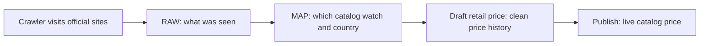

# Overview and Glossary

## In plain words

**What is retail price?** The price a watch manufacturer lists for a watch reference on its own official website, in a given country and currency. It is not an auction or dealer price. We keep it as a history: every time the manufacturer changes the price, we add a new row with the date.

**Why we have it.** It lets us show what a watch costs new, and how that price has changed over time, per country.

**How it gets in, in one paragraph.** Crawlers visit manufacturer websites and save what they see (a "raw" listing: reference number, price, currency, whether it is still listed). A daily process links each raw listing to a watch in our catalog and a country. Another step turns the price history of each linked listing into clean price-change rows in a draft table, skipping noise, duplicates and suspicious jumps. Finally a publish step copies the approved rows to the live catalog table.

**Three safeguards to remember**
1. **Only official sources.** Only listings from sources marked OFFICIAL feed the flow.
2. **Suspicious prices wait for a human.** A price that jumps more than 50% against the previous one is saved as "pending" (StatusID 2) and is not published until someone approves it.
3. **One price per day.** If a price changes several times in a day, only the last one is kept. A price equal to the previous one is not added again.

## Glossary

| Term | Meaning |
|---|---|
| **Catalog / CatalogId** | A watch reference in our catalog (`tbl_CAT_Catalog_d`). Prices attach to a catalog watch plus a country. |
| **Official source** | A crawl source whose catalog source name contains "OFFICIAL" in `tbl_sourceManufacturer_mapping`. Only these are mapped. |
| **RAW** | `tbl_RAW_Catalog`: the crawler's current view of each listing. One row per listing. |
| **Mirror** | `tbl_raw_catalog_m`: a history of old versions of RAW rows. Each time a RAW row is changed or deleted, its previous version is saved here. |
| **MAP** | `tbl_MAP_RawCatalog_CatalogCountry`: links one RAW listing to one CatalogId and one CountryId. At most one active link per catalog and country. |
| **Ambiguous** | A RAW listing that matches more than one catalog; parked in `tbl_MAP_RawCatalog_CatalogCountry_Ambiguous` instead of guessing. |
| **Draft (`_d`) table** | `tbl_CAT_CatalogRetailPrice_d`: the working retail price table where new prices are inserted. |
| **Published table** | `tbl_CAT_CatalogRetailPrice`: the live copy, filled by the publish step. |
| **StatusID (retail price)** | 1 = normal (will be published). 2 = pending review, an outlier (not published). 3 = deleted (removes the published row). |
| **IsVerified** | 1 = price came from the manufacturer's official website. The daily update SP sets this on every row it inserts. |
| **IsPrivate** | 1 = private price stream (not created by the daily flow, which always writes 0). |
| **IsSeenInLastRun** | Is the listing still on the manufacturer's site as of the last crawl. On RAW and MAP it comes from the crawler; on retail rows it starts at 0. |
| **PriceLastSeenDate** | The last date a price was seen. Set on the MAP table by `sp_UpdateMap_PriceLastSeen`. On retail rows it is NULL at insert. |
| **EffectiveDate** | The date a price is considered to have started. For the current RAW row it is `UpdatedDate`; for history rows it is derived (see the update SP doc). It becomes `CreatedAt` on the retail row. |
| **TransactionId** | A batch stamp. RAW rows carry the crawler load's id; retail rows carry the id of the insert batch (`tblTransaction`). |
| **Watermark** | The highest RAW `TransactionId` already handled by the update SP, kept in `tbl_cat_RetailPrice_SyncLog`. Next run only looks at RAW rows above it. |
| **Reference guard** | A check that the reference number on a listing really matches the catalog's reference before its price is used. |
| **Outlier rule** | A new price differing more than 50% from the baseline price is inserted with StatusID 2 instead of 1. |
| **Same-day collapse** | Several price points on the same calendar day collapse to the last one. |
| **Currency gate** | The source's expected currency (`tbl_sourceManufacturer_mapping.Currency`); a row in another currency is dropped. |
