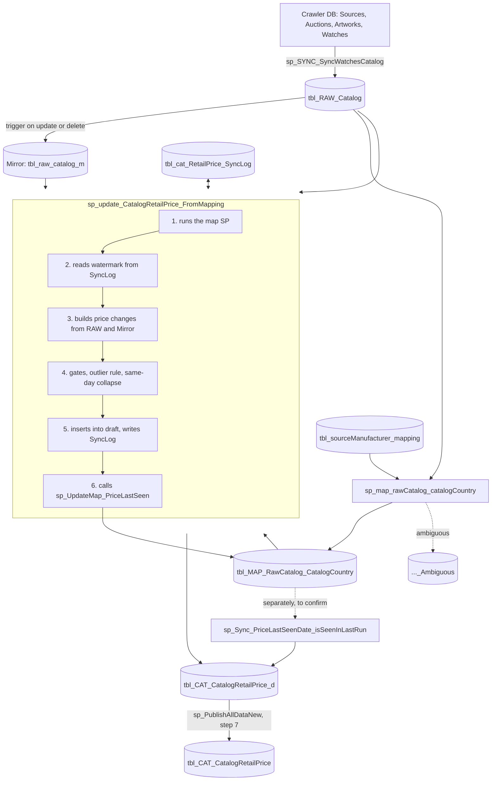

# End-to-End Flow

## In plain words

1. Crawlers save listings from manufacturer sites. A load job copies them into our database (RAW). Every time a RAW row changes, its previous version is saved (Mirror).
2. Once a day, the retail update job first links RAW listings to catalog watches and countries (MAP).
3. The same job turns each linked listing's price history into price changes and adds only new ones to the draft retail table.
4. It then records, on the MAP table, when each price was last seen.
5. A publish step copies approved draft prices to the live table.

## Diagram (current flow)

## Stages

| # | Stage | Procedure | Reads | Writes | Frequency |
|---|---|---|---|---|---|
| 1 | Load crawler data | `sp_SYNC_SyncWatchesCatalog` | Crawler DB (linked server) | `tbl_RAW_Catalog`, `tblTransaction` | ~hourly (**to confirm**) |
| 1a | Keep history | trigger on `tbl_RAW_Catalog` | old row version | `tbl_raw_catalog_m` | on every RAW update or delete |
| 2 | Link listings to catalog + country | `sp_map_rawCatalog_catalogCountry` | RAW, Mirror, `tbl_sourceManufacturer_mapping`, `tbl_CAT_Catalog_d`, `tbl_CAT_RawCatalogMapping` | `tbl_MAP_RawCatalog_CatalogCountry`, `..._Ambiguous` | Called first by the update SP |
| 3 | Insert new retail prices | `sp_update_CatalogRetailPrice_FromMapping` | RAW, Mirror, MAP, draft retail, currency, source mapping, SyncLog | `tbl_CAT_CatalogRetailPrice_d`, `tblTransaction`, `tbl_cat_RetailPrice_SyncLog` | Daily (**schedule to confirm**) |
| 4 | Record last-seen date on MAP | `sp_UpdateMap_PriceLastSeen` | draft retail, RAW, Mirror, MAP | MAP `PriceLastSeenDate` | Called by the update SP at its end |
| 5 | Copy IsSeenInLastRun to retail rows | `sp_Sync_PriceLastSeenDate_isSeenInLastRun` | MAP | draft retail `IsSeenInLastRun` | Called by the update SP after step 4 (call commented out temporarily for manual dry-run testing) |
| 6 | Publish | `sp_PublishAllDataNew` (step 7) | draft retail | `tbl_CAT_CatalogRetailPrice` | On publish |

## Where a retail price is "added"

A retail price row is created in exactly one place: the INSERT at the end of `sp_update_CatalogRetailPrice_FromMapping` into `tbl_CAT_CatalogRetailPrice_d`. Every other stage prepares data for it, adjusts flags on it, or copies it onward. Rows inserted there always have: `IsVerified = 1`, `IsPrivate = 0`, `IsSeenInLastRun = 0`, `PriceLastSeenDate = NULL`, `StatusID` 1 or 2.

## Run order (as understood, to confirm in SQL Agent)

No SQL Agent job definitions exist in the repositories. From the code:
1. `sp_SYNC_SyncWatchesCatalog` runs on its own schedule.
2. The daily retail job runs `sp_update_CatalogRetailPrice_FromMapping`, which itself runs the map SP first and `sp_UpdateMap_PriceLastSeen` last.
3. `sp_PublishAllDataNew` runs when data is published.
4. `sp_Sync_PriceLastSeenDate_isSeenInLastRun` is part of the update SP (after `sp_UpdateMap_PriceLastSeen`), not a separate job step. Its call is commented out temporarily for manual dry-run testing.
