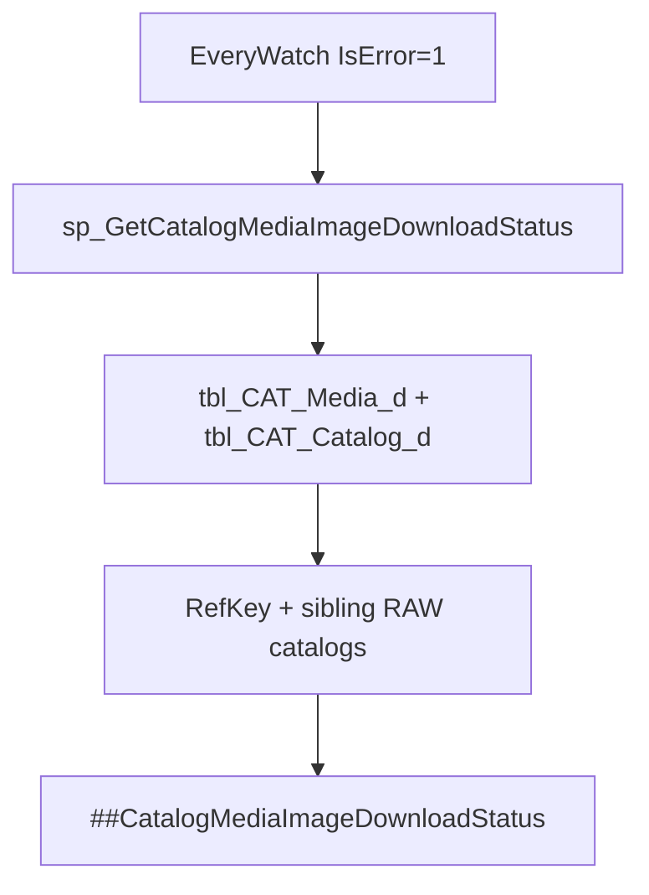

# Catalog media image download status (single batch SP)

## Confirmed decisions

| # | Decision |
|---|----------|
| 1 | **All errored media in driver** — every enrichment row with `IsError = 1` and valid `CatalogMediaId` lands in `##CatalogMediaImageDownloadStatus` |
| 1b | **Same §3 for every row** — `ImageDownloadStatus` **1** / **2** / **3**, plus RAW slot ids. **Only difference for non-primary:** `UpdatedImage` = `NULL` |
| 2 | **Catalog source:** [`tbl_CAT_Media_d`](d:\EW\ew-db\MasterDB\dbo\table\tbl_CAT_Media_d.sql) only |
| 3 | **Output:** global temp `##CatalogMediaImageDownloadStatus` (same session export) |
| 4 | **Column cleanup:** no persisted `ImageDownloadStatus` / `ArtworkPhotosId` on catalog media tables |
| 5 | **§4 primary:** cross-catalog by normalized ref (`fn_ExtractNumbersAndAlphabets`), `tbl_sourceManufacturer_Mapping` (prod; `CatSourceName` `%OFFICIAL%`), not single `RawCatalogId` only |

## Supersedes (dropped)

| Dropped | Reason |
|---------|--------|
| `sp_SetCatalogMediaImageDownloadStatus` | No per-error CMS SP |
| Crawl notify on error | Elsewhere |
| Persisted status on `tbl_CAT_Media` | Batch-only |

---

## 1. Stored procedure

**Name:** `dbo.sp_GetCatalogMediaImageDownloadStatus`  
**File:** [`sp_GetCatalogMediaImageDownloadStatus.sql`](d:\EW\ew-db\MasterDB\dbo\stored procedures\sp_GetCatalogMediaImageDownloadStatus.sql)

---

## 2. Global temp output (`##CatalogMediaImageDownloadStatus`)

| Column | Source |
|--------|--------|
| `CatalogId`, `ReferenceNumber`, `SourceLink` | `tbl_CAT_Catalog_d` |
| `MediaId`, `IsPrimary`, `Url` | `tbl_CAT_Media_d` |
| `ImageDownloadStatus`, `ArtworkPhotosId`, `RawCatalogId` | §3 |
| `RawMediaId`, `SourceId`, `AuctionId`, `ArtworkId` | Slot `tbl_RAW_Media` |
| `RawReferenceNo`, `RawCatalogIsSeenInLastRun` | Slot `tbl_RAW_Catalog` |
| `RawCatalogIsDeleted` | `tbl_RAW_Catalog.IsDeleted` for slot catalog |
| `UpdatedImage` | §4 if `IsPrimary = 1`, else `NULL` |

---

## 3. ImageDownloadStatus (unchanged)

Exact `Photo = Url`; prefer active row: `ORDER BY rm.IsDeleted ASC, rm.UpdatedDate DESC`.

| Value | Meaning |
|-------|---------|
| `1` | Active RAW match |
| `2` | Deleted RAW match only |
| `3` | No match |

---

## 4. UpdatedImage — catalog ref vs slot (RAW) ref

**RefKey** = normalized `tbl_CAT_Catalog_d.ReferenceNumber`  
**SlotRefKey** = normalized slot `tbl_RAW_Catalog.ReferenceNo` (URL-match catalog)

**When `RefKey` <> `SlotRefKey` (catalog ref differs from RAW slot ref):**

1. `UpdatedImage` only from `#SiblingMediaCatalog`: `LTRIM(RTRIM(ReferenceNo)) = LTRIM(RTRIM(ReferenceNumber))` for that `CatalogId` (e.g. catalog `862.10.021.10` → crawl listing `862.10.021.10`, not slot `861.10.021.20`).
2. **No** slot `Photo` when `Photo <> Url` on the URL-match row (shared broken URL must not assign slot image to wrong catalog ref).
3. **No** normalized ref-key sibling pool for catalog primary (not `fn_ExtractNumbersAndAlphabets` family).
4. Do **not** use same-`orderIndex` replacement on the shared slot `RawCatalogId`.

**When `RefKey` = `SlotRefKey` (same ref):**

1. Same-`orderIndex` active photo on slot `RawCatalogId` (newest `UpdatedDate`).
2. Then RAW siblings for **`SlotRefKey`** (strict, then fallback).

No `tbl_CAT_RawCatalogMapping`.

**Strict primary** (one row per `RefKey` + `ManufacturerId`): active media ranked by

1. `IsSeenInLastRun = 1`
2. `CatSourceName` like `%OFFICIAL%` on mapping
3. Min `orderIndex`, then `tbl_RAW_Media.Id`

**Fallback primary:** same sibling set, `ORDER BY orderIndex ASC` only (when strict photo is NULL or equals catalog `Url`).

**Effective primary:** strict photo, else fallback; NULL if still equals `Url`.

| Case | `UpdatedImage` (primary only) |
|------|-------------------------------|
| Status `3` or no `RawCatalogId` | `NULL` |
| Active slot, `Photo <> Url` (catalog ref = slot ref only) | Slot `Photo` |
| Catalog ref ≠ slot ref | `EffectivePrimary` from exact catalog `ReferenceNumber` crawl only |
| Active slot, `Photo = Url`, `orderIndex` = ref-primary `orderIndex` | `NULL` |
| Active slot, `Photo = Url`, `orderIndex` > ref-primary | `EffectivePrimary` |
| Slot deleted or status `2` | `EffectivePrimary` |

---

## 5. Performance (batch SP)

| Step | Cost |
|------|------|
| `#DistinctUrl` → `tbl_RAW_Media` on `Photo` | One full media scan (~2M rows); no index on `Photo` |
| `#SiblingMediaCatalog` + `#SiblingMedia` | Exact catalog ref pass + normalized slot-ref pass for same-ref rows |
| Primary strict/fallback ×4 | Rank in temp only — no extra catalog scan |
| `#SlotOrderReplace` | Index seek on `RawCatalogId` per same-ref rows |

Further gains need persisted `Photo` lookup table or `ReferenceNo` key column on `tbl_RAW_Catalog`.

---

## 6. Deploy

1. Confirm `dbo.tbl_sourceManufacturer_Mapping` and `CatSourceName` exist on EWMaster (not in committed `tbl_source_manufacturer_mapping.sql`).
2. `CREATE OR ALTER` batch SP.
3. `EXEC dbo.sp_GetCatalogMediaImageDownloadStatus` — export `##` in same session.

---

## 7. Verification

| Setup | Status | UpdatedImage (primary) |
|-------|--------|---------------------------|
| Active RAW, URL changed on slot | 1 | Slot `Photo` |
| Active RAW, same URL, slot at ref-primary min `orderIndex` | 1 | `NULL` |
| Active RAW, same URL, higher `orderIndex` than ref-primary | 1 | Strict/fallback sibling primary |
| Slot deleted or URL only on deleted RAW | 2 | Strict/fallback sibling primary |
| No RAW URL | 3 | `NULL` |
| Primary from official+seen catalog differs from slot catalog | 1 | Cross-catalog primary |
| Non-primary | 1/2/3 | `NULL` |
