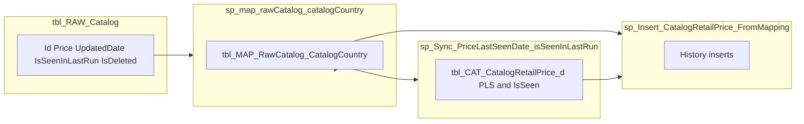

# Mapping + retail pipeline (as-built review)

This document reflects **finalized MasterDB code** in `ew-db` for: **`IsSeenInLastRun`**, **`PriceLastSeenDate`**, **`RawCatalogUpdatedDate`**, **`tbl_MAP_RawCatalog_CatalogCountry`**, **Daily / OneTime mapping**, **sync to catalog retail**, and **`sp_Insert_CatalogRetailPrice_FromMapping`**.

---

## 1. `tbl_MAP_RawCatalog_CatalogCountry` (one row per `RawCatalogId`)

| Column | Meaning (as implemented) |
|--------|---------------------------|
| **RawCatalogId** | FK to `tbl_RAW_Catalog.Id`. |
| **CatalogId / CountryId** | Resolved official listing → catalog + country. |
| **IsSeenInLastRun** | Copied from raw: `1` if `tbl_RAW_Catalog.IsSeenInLastRun >= 1`, else `0` (Daily **UPDATE**; insert path uses aggregated value from resolution). |
| **IsDeleted** | Follows raw `IsDeleted`. |
| **PriceLastSeenDate** | “Price signal” timestamp for map/sync (see §2). **Not** the same as `RawCatalogUpdatedDate`. |
| **RawCatalogUpdatedDate** | **`tbl_RAW_Catalog.UpdatedDate`** on the map row. **Daily** does **not** set it on UPDATE; **Daily INSERT** leaves **NULL** until **`sp_UpdateMap_PriceLastSeen`** runs **after** retail insert. **OneTime** backfill may set it on insert. |
| **MappingCreatedAt** | Row creation (default UTC). |
| **MappingUpdatedAt** | When SQL last wrote the map row (`SYSUTCDATETIME()` on Daily **UPDATE**) — **not** raw business time. |
| **ResolutionNote** | Mapping vs catalog-fallback hint on insert. |

**Deploy:** existing DBs need  
`ALTER TABLE dbo.tbl_MAP_RawCatalog_CatalogCountry ADD RawCatalogUpdatedDate datetime2(7) NULL;`  
(see table script comment).

**Invariant:** at most **one active** (`IsDeleted = 0`) row per `(CatalogId, CountryId)` (filtered unique index). Retail watermark joins assume **≤1** active map row per pair.

---

## 2. `PriceLastSeenDate` on the map row (`sp_UpdateMap_PriceLastSeen`; OneTime insert)

Same **`CASE`** in **PriceLastSeen** SP (and OneTime backfill):

| Raw `IsSeenInLastRun` (≥1 → 1) | Raw `Price` | Map `PriceLastSeenDate` |
|--------------------------------|---------------|-------------------------|
| **1** | Non-zero | **`NULL`** — listing seen in crawl with price; do **not** stamp raw `UpdatedDate` as PLS. |
| **1** | Zero / null | Mirror **effective date** (`#MirrorBestPrice` / mirror EffectiveDate CASE). |
| **0** | Non-zero | Raw **`UpdatedDate`**. |
| **0** | Zero / null | Mirror effective date. |

**Why NULL seen+priced on the map row:** avoids stamping raw **`UpdatedDate`** as PLS when the listing is seen with a price. **`MAX`** over map rows can still be **`NULL`** if every row’s PLS is NULL; sync then sets retail **`PriceLastSeenDate`** to **`NULL`** as well (no stale date).

---

## 3. `RawCatalogUpdatedDate` on the map row

- **Meaning:** crawl **`tbl_RAW_Catalog.UpdatedDate`** when populated on the map row (watermark **`COALESCE`** in retail insert when retail PLS is null).
- **Daily:** **UPDATE** does **not** touch **`RawCatalogUpdatedDate`** (avoids watermark jump before insert). **INSERT** leaves **NULL**.
- **After retail insert:** **`sp_UpdateMap_PriceLastSeen`** sets **`RawCatalogUpdatedDate = CAST(raw.UpdatedDate AS datetime2(7))`** together with **`PriceLastSeenDate`**.
- **OneTime INSERT:** may set **`RawCatalogUpdatedDate`** from raw on backfill.

---

## 4. Daily vs OneTime vs PriceLastSeen SP

| Concern | **Daily** (`sp_map_rawCatalog_catalogCountry`) | **PriceLastSeen** (`sp_UpdateMap_PriceLastSeen`) | **OneTime** (`sp_MAP_RawCatalog_CatalogCountry_OneTime`) |
|---------|------------------------------------------------------|-------------------------------------------------------------------------------|-----------------------------------------------------------|
| **Existing map rows** | **UPDATE** `IsSeenInLastRun`, `IsDeleted`, `MappingUpdatedAt` only. | **UPDATE** `PriceLastSeenDate`, `RawCatalogUpdatedDate`, `MappingUpdatedAt` (same PLS CASE as before). | **Does not** update existing map rows. |
| **New map rows** | **INSERT** with `IsSeenInLastRun`; **NULL** PLS + **NULL** `RawCatalogUpdatedDate`. | Fills **PLS** + **`RawCatalogUpdatedDate`** when they drift from raw (after insert). | Sets PLS + `RawCatalogUpdatedDate` on insert (backfill path only). |
| **Mirror temp tables** | `#IdsMirrorRef` only (ref fallback). | `#IdsMirrorPrice` + EffectiveDate pass. | Both passes (unchanged). |

**Why split steps:** **`PriceLastSeenDate`** and **`RawCatalogUpdatedDate`** must **not** advance on the map **before** **`sp_Insert_CatalogRetailPrice_FromMapping`**, or the retail watermark (**`COALESCE(retail.PLS, map.RawCatalogUpdatedDate, …)`**) can skip mirror rows whose **EffectiveDate** is older than the new map dates. **Daily** only refreshes **`IsSeenInLastRun`** / **`IsDeleted`**; **post-insert SP** applies **`RawCatalogUpdatedDate`** + **`PriceLastSeenDate`**; **sync** pushes aggregates to **`tbl_CAT_CatalogRetailPrice_d`**.

**Suggested job order:** **Daily** → **`sp_Insert_CatalogRetailPrice_FromMapping`** (when `@DryRun = 0`, calls **PriceLastSeen** at end) → **`sp_Sync_PriceLastSeenDate_isSeenInLastRun`**.

---

## 5. `sp_Sync_PriceLastSeenDate_isSeenInLastRun` (map → catalog retail)

- **Input:** active map rows (`IsDeleted = 0`), grouped by **`(CatalogId, CountryId)`**.
- **Writes to** `tbl_CAT_CatalogRetailPrice_d` (draft public slice: `StatusID = 1`, `IsPrivate = 0`, joined to live catalog):
  - **`IsSeenInLastRun`** = `MAX` of map flags (any raw seen → 1).
  - **`PriceLastSeenDate`** = **`MAX(map.PriceLastSeenDate)`** per pair, **including** when that aggregate is **`NULL`** (retail PLS is **cleared** to match “no PLS signal” from mapping).
- **`tblTransaction`:** one row per sync run — **`TransactionTypeID = 2`**, **`UserID = @UserId`** (default **1**), `SCOPE_IDENTITY()` stored in **`@TransactionId`**.
- **`TransactionId` on retail rows:** set for **every** row this sync **updates** — whenever **`IsSeenInLastRun`** and/or **`PriceLastSeenDate`** (vs the map aggregate, including **NULL**) **differs** from what is already on retail.
- **IsNational:** not present on `tbl_CAT_CatalogRetailPrice_d` (or joined dimensions) in MasterDB scripts; extend **`TransactionId`** rules when a reliable flag exists (e.g. national vs regional country).

---

## 6. `sp_Insert_CatalogRetailPrice_FromMapping` (catalog retail **history** insert)

**Inputs:** `tbl_MAP_RawCatalog_CatalogCountry` (+ raw/mirror streams, ref guards, source currency gate, etc. — see procedure header).

**Date gate (`#RetailPriceLastSeen` → `#PriceChangesAfterPLS`):** calendar **day** only.

1. **When public draft retail already exists** for `(CatalogId, CountryId)` among this run’s candidates:  
   **`#RetailPriceLastSeen`** = **`MAX( date( COALESCE( retail.PriceLastSeenDate, map.RawCatalogUpdatedDate, retail.CreatedAt ) ) )`**  
   over **`tbl_CAT_CatalogRetailPrice_d`** (`StatusID = 1`, `IsPrivate = 0`), **`LEFT JOIN`** active map.

2. **First-time pair (no public draft retail at all for that Catalog+Country):** **no** row in **`#RetailPriceLastSeen`** for that pair → **`LEFT JOIN`** yields **`pls.CatalogID IS NULL`** → **all** price-change candidates pass the date gate (full history from raw/mirror, then downstream % diff / same-day / merge rules still apply).

3. **Filter:**  
   `pls.CatalogID IS NULL OR pls.PriceLastSeenDate IS NULL OR CAST(pc.EffectiveDate AS date) > pls.PriceLastSeenDate`.

**First-time catalog + country (no public draft retail yet):** yes — **all** candidates that survive the rest of the pipeline (including **price-difference / same-day / merge / status** logic) can be inserted; the date gate does **not** trim by `RawCatalogUpdatedDate` for that pair.

**`tblTransaction` on insert:** when **`@DryRun = 0`**, one row **`TransactionTypeID = 1`**, **`UserID = 1`**, `GETDATE()`; **all** inserted retail rows use that **`SCOPE_IDENTITY()`** for the batch. Parameter **`@TransactionId`** is reserved / unused for inserts (see procedure header).

**After insert (`@DryRun = 0`):** **`EXEC sp_UpdateMap_PriceLastSeen`** refreshes map **`PriceLastSeenDate`** and **`RawCatalogUpdatedDate`** (**`IsSeenInLastRun`** / **`IsDeleted`** unchanged — set by Daily).

**Other logic:** ref guard, `IsPrivate = 0` baselines, source currency gate, upcoming baseline for % diff when no catalog retail, merged timeline, `StatusID` / dry run, **exclude `tbl_RAW_Catalog` / mirror rows with `IsDeleted = 1`** for retail candidates, etc.

---

## 6b. Soft-deleted raw listings (`IsDeleted`)

**Policy (from 2026-05):** Retail price ingest must **not** use listings removed from the manufacturer crawl (`tbl_RAW_Catalog.IsDeleted = 1`). That **`RawCatalogId`** is skipped on the **RAW** path and gated on the **MIRROR** path (current primary row must be active; each **`tbl_RAW_Catalog_m`** snapshot with **`IsDeleted = 1`** is ignored).

**Code:** **`sp_Insert_CatalogRetailPrice_FromMapping`** — RAW path `ISNULL(trc.IsDeleted, 0) = 0`; MIRROR path `ISNULL(trc.IsDeleted, 0) = 0` on mirror plus join to primary `rawCur` with `IsDeleted = 0`. **`sp_map_rawCatalog_catalogCountry`** / **OneTime** — `ISNULL(mm.IsDeleted, 0) = 0` on mirror reads for `#MirrorBestRef` / `#MirrorBestPrice`.

**Map row:** Daily still sets **`map.IsDeleted`** from raw; sync aggregate already excludes **`map.IsDeleted = 1`**.

---

## 7. End-to-end flow (mermaid)

---

## 8. Loopholes, edge cases, and “nothing missing” checklist

| Topic | Assessment |
|-------|------------|
| **NULL map `PriceLastSeenDate` (seen + priced)** | Per-row NULL on map by design; if **all** rows for the pair are NULL, aggregate is NULL and **sync clears** retail PLS to NULL. |
| **NULL `RawCatalogUpdatedDate` on map** | Still used inside **`RetailAgg` COALESCE** when retail exists; if null, falls back to **`CreatedAt`**. |
| **OneTime vs ongoing refresh** | OneTime **does not** UPDATE existing map rows; **Daily** is required for flags on existing rows; **PLS** + **`RawCatalogUpdatedDate`** after retail insert via **`sp_UpdateMap_PriceLastSeen`**. |
| **Multiple active map rows per pair** | Violates intended unique index; rely on DB constraint. |
| **Retail insert vs sync PLS** | Insert uses map **`RawCatalogUpdatedDate`** only inside **`RetailAgg`** (when retail already exists). Sync does not copy that column to catalog. |
| **Private retail** | Excluded from watermark **`RetailAgg`** (same grain as rest of procedure). |
| **Job order** | Prefer **map (`sp_map_rawCatalog_catalogCountry`) → insert → PriceLastSeen → sync (`sp_Sync_PriceLastSeenDate_isSeenInLastRun`)**. |
| **Soft-deleted raw (`IsDeleted = 1`)** | Retail insert + mapping mirror helpers ignore deleted raw and deleted mirror snapshots; see §6b. |

---

## 9. Files (reference)

| Area | Path |
|------|------|
| Map table | [`MasterDB/dbo/table/tbl_MAP_RawCatalog_CatalogCountry.sql`](d:/EW/ew-db/MasterDB/dbo/table/tbl_MAP_RawCatalog_CatalogCountry.sql) |
| Daily mapping | [`MasterDB/dbo/stored procedures/sp_map_rawCatalog_catalogCountry.sql`](d:/EW/ew-db/MasterDB/dbo/stored procedures/sp_map_rawCatalog_catalogCountry.sql) |
| OneTime mapping | [`MasterDB/dbo/stored procedures/sp_MAP_RawCatalog_CatalogCountry_OneTime.sql`](d:/EW/ew-db/MasterDB/dbo/stored procedures/sp_MAP_RawCatalog_CatalogCountry_OneTime.sql) |
| Sync | [`MasterDB/dbo/stored procedures/sp_Sync_PriceLastSeenDate_isSeenInLastRun.sql`](d:/EW/ew-db/MasterDB/dbo/stored procedures/sp_Sync_PriceLastSeenDate_isSeenInLastRun.sql) |
| Retail insert | [`MasterDB/dbo/stored procedures/sp_Insert_CatalogRetailPrice_FromMapping.sql`](d:/EW/ew-db/MasterDB/dbo/stored procedures/sp_Insert_CatalogRetailPrice_FromMapping.sql) |
| Map PLS refresh | [`MasterDB/dbo/stored procedures/sp_UpdateMap_PriceLastSeen.sql`](d:/EW/ew-db/MasterDB/dbo/stored procedures/sp_UpdateMap_PriceLastSeen.sql) |

---

## 10. Conclusion

**Daily** maintains map **IsSeenInLastRun** and **IsDeleted** (and inserts new rows with **NULL** **PLS** / **RawCatalogUpdatedDate** until step 3). **Retail insert** runs next; then **`sp_UpdateMap_PriceLastSeen`** sets map **PriceLastSeenDate** and **RawCatalogUpdatedDate**. **Sync** copies **`MAX`** map **IsSeenInLastRun** and **`MAX`** map **PriceLastSeenDate** (including **NULL** aggregate clearing retail PLS) to **`tbl_CAT_CatalogRetailPrice_d`**, stamping **`TransactionId`** when either differs (**TransactionTypeID = 2**). Retail insert uses a **date gate only when draft retail already exists** for the pair (otherwise **full** candidate timeline); insert batch uses one **`tblTransaction`** (**type 1**, user **1**). Add **IsNational** to the sync **`TransactionId`** rule when the column exists in schema.
