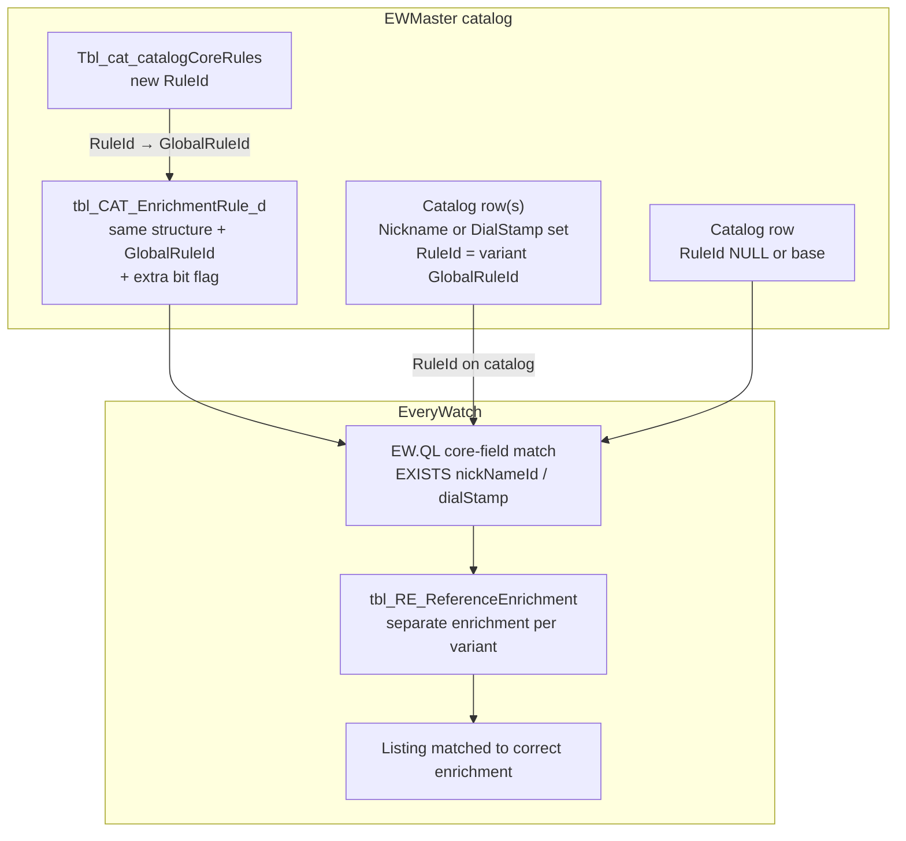

# Catalog enrichment — Paul Newman, Tiffany, and Patek dial-stamp variations

This document describes how **high-value dial variants** are modeled in **EWMaster** and **EveryWatch**: separate catalog products, separate **global enrichment rules**, and separate enrichments from the “standard” watch with the same reference structure. It complements [Catalog-Enrichment-Rules-Documentation.md](Catalog-Enrichment-Rules-Documentation.md).

**Database:** EWMaster (`ew-db/MasterDB`) + EveryWatch (runtime matching)  
**Variants covered here:**

| Variant | Manufacturer | Reference(s) | Catalog discriminator | Extra enrichment rule check |
|---------|--------------|--------------|----------------------|----------------------------|
| **Paul Newman dial** | Rolex | Various (e.g. Daytona families) | **Nickname** = `Paul Newman` | `Nickname = 1` on alternative rule |
| **Tiffany & Co. dial** | Patek Philippe | Various | **Dial stamp** (Tiffany & Co.) | `DialStamp = 1` on alternative rule |
| **Retailer / signature dials** | Patek Philippe | **2499**, **1517** | **Dial stamp** (Trucchi, Tiffany, Serpico, …) | `DialStamp = 1` per stamp variant |

---

## 1. Business problem

Some Rolex and Patek watches share the **same reference number / structure** as a common model but carry a **special dial** that commands a **much higher market price** than the standard dial. Examples:

- **Rolex Daytona (and other models)** with a **Paul Newman** dial  
- **Patek Philippe** watches with a **Tiffany & Co.** signed or stamped dial  
- **Patek Philippe 2499 and 1517** watches with other **signature / retailer dial stamps** (e.g. **Trucchi**, **Tiffany**, **Serpico**) that also trade at premiums distinct from the “plain” same-reference catalog line  

If catalog and enrichment treated these only as “same reference + dial color + case material,” they would collapse into **one** product and **one** enrichment — wrong for pricing, editorial, and watch matching.

**Goal:** Treat each variant as its **own catalog row** and **own enrichment path**, while reusing the same underlying reference structure (e.g. `XXXX` / `6263` / `5711` mask).

---

## 2. Solution pattern (shared by all variants)



| Layer | Base (standard dial) | Variant (Paul Newman / Tiffany / 2499·1517 stamps) |
|-------|----------------------|-----------------------------------------------------|
| **Catalog identity** | Reference + usual facets; no variant nickname/stamp | Same reference structure **plus** `NicknameId` or `DialStampId` |
| **`tbl_CAT_Catalog.RuleId`** | `NULL` or existing base `GlobalRuleId` | **`GlobalRuleId`** from new `Tbl_cat_catalogCoreRules` row |
| **`tbl_CAT_EnrichmentRule_d`** | Rule for structure `XXXX` without extra bit | **Alternative** rule: same `EnrichmentStructureId` / parent tiers, **`GlobalRuleId` = new RuleId**, **one extra bit = 1** |
| **Runtime EWQL** | `… referenceStructure = 'XXXX' AND EXISTS(dialColorIds) …` | Same structure clause **plus** `EXISTS(nickNameId)` or `EXISTS(dialStamp)` |
| **EveryWatch listings** | Match base enrichment | Watches with Paul Newman / Tiffany attributes match **variant** enrichment |

---

## 3. Paul Newman (Rolex) — nickname variation

### 3.1 Why nickname

Paul Newman dials are identified in the catalog by a dedicated **nickname** value (**Paul Newman** in `tbl_CAT_Nickname_d`), not only by dial color text. That keeps variant catalog rows explicit and aligns with how the market names the watch.

EveryWatch listings that carry this dial should resolve to enrichments that **require nickname** in addition to the usual structure-based checks (dial color, case material, etc.).

### 3.2 Catalog side

| Item | Detail |
|------|--------|
| Lookup | `tbl_CAT_Nickname_d` — `NicknameName` = `Paul Newman` (must exist and be active before catalog create) |
| Catalog column | `tbl_CAT_Catalog_d.NicknameId` → FK to nickname |
| Create path | `sp_Create_Catalog` accepts `@NicknameName` / resolves `@NicknameId` |
| Variant link | `tbl_CAT_Catalog_d.RuleId` = alternative **`GlobalRuleId`** (see §6) |

**Editorial:** Each Paul Newman catalog entry is still tied to the normal **reference number**; the nickname marks it as the Newman variant for the same structure family.

### 3.3 Enrichment rule side

For the **same reference structure** as the base Rolex rule (e.g. structure mask `XXXX` on the relevant parent/child tiers):

1. Keep the **existing** global rule row(s) with `GlobalRuleId IS NULL` (or the original base id) — checks dial color, case material, etc., **without** requiring nickname.  
2. Add an **alternative** row in **`tbl_CAT_EnrichmentRule_d`** with:
   - Same `ManufacturerId` (Rolex)  
   - Same `EnrichmentStructureId` / `ParentStructureId` hierarchy as the base rule for that reference  
   - **`GlobalRuleId`** = new id from **`Tbl_cat_catalogCoreRules`** (§6)  
   - **All base-tier bit flags** copied from the standard rule for that structure **plus** **`Nickname = 1`** (the extra discriminator)

At runtime, `GlobalRuleSyncService` turns `Nickname = 1` into EWQL `EXISTS(nickNameId)` so only watches (and catalog rows) with a nickname populated match this template.

### 3.4 Listing / watch data

On EveryWatch, draft watches (`tblWatch_d`) that are Paul Newman variants should carry **`NickNameId`** (or be linked to catalog that carries nickname) so core-field matching selects the **variant** global rule, not the base rule.

---

## 4. Tiffany & Co. (Patek Philippe) — dial stamp variation

### 4.1 Why dial stamp

Tiffany-signed Patek dials are distinguished by **dial stamp** (Tiffany & Co. on the dial), not by the Paul Newman nickname pattern. Catalog uses **`DialStampId`** / `DialStamp` on `tbl_CAT_Catalog_d`.

Market prices for Tiffany-stamped references are similarly separated from non-Tiffany examples of the same reference structure.

### 4.2 Catalog side

| Item | Detail |
|------|--------|
| Lookup | `tbl_CAT_DialStamp_d` — stamp name for Tiffany & Co. variant |
| Catalog columns | `DialStampId`, `DialStamp` on `tbl_CAT_Catalog_d` |
| Create path | `sp_Create_Catalog` — `@DialStampName` → `@DialStampId` |
| Variant link | `RuleId` = alternative **`GlobalRuleId`** from `Tbl_cat_catalogCoreRules` |

### 4.3 Enrichment rule side

Same pattern as Paul Newman, but the **extra bit** on the alternative rule is **`DialStamp = 1`** (not `Nickname`):

- Same Patek **reference structure** as the base rule  
- **`GlobalRuleId`** = new `RuleId` from `Tbl_cat_catalogCoreRules`  
- Base facets (dial color, case material, …) **plus** **`DialStamp = 1`**

Runtime EWQL adds `EXISTS(dialStamp)` for that rule variant.

### 4.4 Listing / watch data

Watches with Tiffany dial attribution need **`DialStamp`** populated (or catalog linkage) so matching prefers the Tiffany global rule / enrichment.

---

## 5. Patek Philippe refs **2499** & **1517** — Trucchi, Tiffany, Serpico, and other dial stamps

### 5.1 Context (later extension)

After the initial **Tiffany & Co.** dial-stamp pattern (§4), editorial added **Patek Philippe** catalog coverage for reference families **2499** and **1517**. These references often appear with **special dial stamps** from retailers or signatures — not only Tiffany, but also names such as:

- **Trucchi**  
- **Tiffany** (Tiffany & Co. stamp on 2499/1517 catalogs)  
- **Serpico**  
- *(Other stamp values as added in `tbl_CAT_DialStamp_d` for those catalogs)*  

Each stamp type is a **different product** from a standard 2499/1517 row with the same case/dial color facets but **no** signature stamp (or a different stamp). Market pricing and enrichment matching must stay separated the same way as for Tiffany on other Patek references.

### 5.2 Same mechanism as §4, scoped by reference

| Step | What we did |
|------|-------------|
| 1 | Ensure **dial stamp** lookup rows exist in **`tbl_CAT_DialStamp_d`** (Trucchi, Tiffany, Serpico, …). |
| 2 | Create **catalog** rows for 2499/1517 with the correct **`ReferenceNumber`**, facets, and **`DialStampId`**. |
| 3 | For **each stamp variant** (and reference structure), **`INSERT`** into **`Tbl_cat_catalogCoreRules`** → obtain a dedicated **`RuleId`** / **`GlobalRuleId`**. |
| 4 | **`sp_create_enrichment_rule`** — alternative rule on the **2499** or **1517** reference structure (same parent/child tiers as the base rule for that ref), with **`@GlobalRuleId`** and **`DialStamp = 1`** (and other base bits aligned with the existing structure rule). |
| 5 | Assign **`tbl_CAT_Catalog_d.RuleId`** (and publish) so each stamp catalog points at its variant id. |
| 6 | **Publish** → rows live in **`tbl_CAT_EnrichmentRule`** (published), not only `_d`. |

There is **one alternative enrichment rule row per stamp variant per structure tier** (each with its own **`GlobalRuleId`**), stored alongside the base 2499/1517 rules in **`tbl_CAT_EnrichmentRule_d`** and promoted to **`tbl_CAT_EnrichmentRule`** on publish.

### 5.3 Storage

| Object | Role |
|--------|------|
| **`tbl_CAT_EnrichmentRule_d`** | Draft alternative rules while editing (create/update SPs) |
| **`tbl_CAT_EnrichmentRule`** | Published rules consumed by **`GlobalRuleSyncService`** and EW.QL |
| **`tbl_CAT_Catalog` / `_d`** | Catalog rows for 2499/1517 with **`DialStampId`** + matching **`RuleId`** |
| **`Tbl_cat_catalogCoreRules`** | One **`RuleId`** per stamp-driven variant (identity → **`GlobalRuleId`**) |

To inspect what was added for these references:

```sql
-- Published enrichment rules for Patek 2499 / 1517 structures (adjust manufacturer id)
SELECT
    e.Id,
    e.GlobalRuleId,
    e.DialStamp,
    rs.ReferenceStructure,
    rs_par.ReferenceStructure AS ParentReferenceStructure,
    d.DialStampName
FROM dbo.tbl_CAT_EnrichmentRule AS e WITH (NOLOCK)
INNER JOIN dbo.tbl_CAT_Manufacturer_d AS m WITH (NOLOCK)
    ON m.ManufacturerId = e.ManufacturerId
LEFT JOIN dbo.tbl_CAT_ReferenceStructure_d AS rs WITH (NOLOCK)
    ON rs.RefStructureId = e.EnrichmentStructureId
LEFT JOIN dbo.tbl_CAT_ReferenceStructure_d AS rs_par WITH (NOLOCK)
    ON rs_par.RefStructureId = e.ParentStructureId
LEFT JOIN dbo.tbl_CAT_Catalog_d AS c WITH (NOLOCK)
    ON c.RuleId = e.GlobalRuleId
LEFT JOIN dbo.tbl_CAT_DialStamp_d AS d WITH (NOLOCK)
    ON d.DialStampId = c.DialStampId
WHERE m.ManufacturerName = N'Patek Philippe'
  AND (
        rs.ReferenceStructure LIKE N'%2499%'
     OR rs.ReferenceStructure LIKE N'%1517%'
     OR c.ReferenceNumber LIKE N'%2499%'
     OR c.ReferenceNumber LIKE N'%1517%'
  )
ORDER BY rs.ReferenceStructure, e.GlobalRuleId, e.DialStamp DESC;
```

Use **`sp_Get_EnrRuleList`** with `@ManufacturerName` + `@ReferenceStructure` for a single ref mask when maintaining rules.

### 5.4 Multiple stamps = multiple `GlobalRuleId`s

Do **not** reuse one Tiffany `GlobalRuleId` for Trucchi or Serpico on 2499/1517. Each stamp line needs:

- Its own **`Tbl_cat_catalogCoreRules`** row (when editorial treats them as separate core-rule variants),  
- Its own **`GlobalRuleId`** on **`tbl_CAT_EnrichmentRule`**, and  
- Catalog rows with that **`RuleId`** and the correct **`DialStampId`**.

Matching then uses **`EXISTS(dialStamp)`** together with **`GlobalRuleId`** from the catalog so listings seed and match the correct enrichment.

### 5.5 Example shape (per stamp, illustrative)

Repeat for **2499** and **1517**, and for each stamp name, after resolving the base rule bits via `sp_Get_EnrRuleList`:

```sql
-- 1) New variant id
INSERT INTO dbo.Tbl_cat_catalogCoreRules (
    ReferenceNumber, CaseMaterial, DialColor, DialStamp, DialFinish, Calibre
)
VALUES (1, 1, 1, 1, 0, 0);  -- align bits with how catalog defines the variant

DECLARE @GlobalRuleId INT = SCOPE_IDENTITY();

-- 2) Alternative rule for 2499 + Serpico (example structure text)
EXEC dbo.sp_create_enrichment_rule
    @ManufacturerName  = N'Patek Philippe',
    @GlobalRuleId       = @GlobalRuleId,
    @ChildRefStructure  = N'2499',              -- use fn_ConvertToStructure mask from base rule
    @DialColor          = 1,
    @CaseMaterial       = 1,
    -- … copy remaining bits from base 2499 rule …
    @DialStamp          = 1,
    @Nickname           = 0;

-- 3) Assign catalogs
UPDATE c
SET c.RuleId = @GlobalRuleId
FROM dbo.tbl_CAT_Catalog_d AS c
INNER JOIN dbo.tbl_CAT_DialStamp_d AS d ON d.DialStampId = c.DialStampId
WHERE d.DialStampName = N'Serpico'            -- exact name in tbl_CAT_DialStamp_d
  AND c.ReferenceNumber LIKE N'%2499%';
```

Run the same pattern for **1517** and for **Trucchi** / **Tiffany** stamp catalogs.

---

## 6. `Tbl_cat_catalogCoreRules` — obtaining `GlobalRuleId`

**File:** `ew-db/MasterDB/dbo/table/Tbl_cat_catalogCoreRules.sql`  
**Object:** `dbo.Tbl_cat_catalogCoreRules`

### 6.1 Role

Before creating an **alternative** enrichment rule, the team registers a new **rule variant id** in this table. The identity column **`RuleId`** becomes:

- **`GlobalRuleId`** on `tbl_CAT_EnrichmentRule_d` / `tbl_CAT_EnrichmentRule`  
- **`RuleId`** on `tbl_CAT_Catalog` / `tbl_CAT_Catalog_d` for all catalog rows that belong to this variant  

`usp_CatToEnrichmentResync` already joins catalog/enrichment data to this table:

```sql
LEFT JOIN [EWMaster].dbo.Tbl_cat_catalogCoreRules TccCR (nolock)
    ON TccCR.RuleId = r.GlobalRuleId;
```

### 6.2 Table columns (summary)

| Column | Meaning |
|--------|---------|
| `RuleId` | **Identity** — assign this as `GlobalRuleId` / catalog `RuleId` |
| `NumberOfField` | Maintained by trigger — count of “active” dimension flags on the row |
| `Manufacturer`, `ReferenceNumber`, `CaseMaterial`, `DialColor`, … | Which **catalog dimensions** define this core-rule variant (bits) |
| `DialStamp`, `DialFinish`, `Edition`, `Calibre`, … | Same — used for catalog grouping / validation semantics |
| `CreatedDate`, `UpdatedDate`, `TransactionId` | Audit |

**Note:** This table does **not** list `Nickname`; Paul Newman is carried on the **enrichment rule** bit grid (`Nickname = 1`) and on **catalog** `NicknameId`. `Tbl_cat_catalogCoreRules` still supplies the **numeric `RuleId`** that ties catalog and enrichment together. The bit columns on the core-rules row should reflect how editorial treats the variant at catalog level (often aligned with which fields differ from base).

### 6.3 Insert a new variant (get `GlobalRuleId`)

**Step 1 — Insert core rule row** (example shape; set bits to match how the variant is defined in catalog):

```sql
INSERT INTO dbo.Tbl_cat_catalogCoreRules (
    Manufacturer,
    ReferenceNumber,
    CaseMaterial,
    DialColor,
    DialMaterial,
    CaseSize,
    BraceletMaterial,
    Model,
    Edition,
    DialStamp,      -- 1 for Tiffany-style variants; 0 for Paul Newman if stamp not used
    DialFinish,
    Calibre
    -- other columns default 0
)
VALUES (
    0, 0, 1, 1, 0, 0, 0, 0, 0,
    0,  -- DialStamp: set 1 when variant is Tiffany dial-stamp driven
    0, 0
);

DECLARE @GlobalRuleId INT = SCOPE_IDENTITY();
SELECT @GlobalRuleId AS GlobalRuleId;  -- use in steps below
```

**Step 2 — Record the id** — use `@GlobalRuleId` in `sp_create_enrichment_rule` as `@GlobalRuleId` and when updating catalogs.

Concrete `RuleId` values are **environment-specific**; always read back `SCOPE_IDENTITY()` (or query the table) rather than hard-coding ids from another environment.

---

## 7. Step-by-step runbook (all variants)

### Phase A — Prepare catalog vocabulary

| Variant | Ensure lookup exists |
|---------|----------------------|
| Paul Newman | `tbl_CAT_Nickname_d`: `Paul Newman` |
| Tiffany (general Patek) | `tbl_CAT_DialStamp_d`: Tiffany & Co. stamp name used in catalog |
| 2499 / 1517 stamps | `tbl_CAT_DialStamp_d`: **Trucchi**, **Tiffany**, **Serpico**, … (exact names as on catalog) |

### Phase B — Register `GlobalRuleId`

1. `INSERT` into **`Tbl_cat_catalogCoreRules`** (§6.3).  
2. Save returned **`RuleId`** as **`@GlobalRuleId`**.

### Phase C — Create alternative enrichment rule

1. Optional: `EXEC dbo.sp_Get_EnrRule_CreateFormat` and copy the parameter block.  
2. `EXEC dbo.sp_create_enrichment_rule` with:
   - `@ManufacturerName` = `Rolex` or `Patek Philippe`  
   - `@GlobalRuleId` = `@GlobalRuleId` from Phase B  
   - `@ChildRefStructure` / `@ReferenceStructure` = same structure as base rule (e.g. `XXXX` / real mask)  
   - Same **parent / GP / GGP** tiers and base bits as the **existing** rule for that structure  
   - **Additionally set the variant bit to 1:**
     - Paul Newman: **`@Nickname = 1`** (and `@PNickname = 1` etc. on parent tiers if those tiers exist)  
     - Tiffany / 2499 / 1517 stamps: **`@DialStamp = 1`** (and tier-prefixed equivalents)

`sp_create_enrichment_rule` will:

- Insert into **`tbl_CAT_EnrichmentRule_d`**  
- Call **`sp_update_catalogTransaction`** for matching reference structures and `@RuleId = @GlobalRuleId`

See [Catalog-Enrichment-Rules-Documentation.md §10](Catalog-Enrichment-Rules-Documentation.md#10-sp_create_enrichment_rule--insert-rules).

### Phase D — Assign `RuleId` to variant catalog rows

Point every **Paul Newman**, **Tiffany**, or **2499/1517 stamp** catalog row at the new rule id:

```sql
-- Example: Paul Newman catalogs (adjust filters to your data)
UPDATE c
SET c.RuleId = @GlobalRuleId,
    c.TransactionID = @NewTransactionId  -- or let a txn SP create one
FROM dbo.tbl_CAT_Catalog_d AS c
INNER JOIN dbo.tbl_CAT_Nickname_d AS n ON n.NicknameId = c.NicknameId
WHERE n.NicknameName = N'Paul Newman'
  AND c.ManufacturerId = @RolexManufacturerId
  AND dbo.fn_ConvertToStructure(c.ReferenceNumber) = @TargetStructure;

-- Example: Tiffany catalogs
UPDATE c
SET c.RuleId = @GlobalRuleId,
    c.TransactionID = @NewTransactionId
FROM dbo.tbl_CAT_Catalog_d AS c
INNER JOIN dbo.tbl_CAT_DialStamp_d AS d ON d.DialStampId = c.DialStampId
WHERE d.DialStampName = N'Tiffany & Co.'  -- use exact catalog name
  AND c.ManufacturerId = @PatekManufacturerId;
```

Or set **`@RuleId`** when creating new catalogs via **`sp_Create_Catalog`**.

**Important:** `sp_update_catalogTransaction` filters catalogs by **`RuleId`** (NULL-safe). After assignment, rule create/update SPs only bump transaction ids for catalogs whose **`RuleId`** matches the variant **`GlobalRuleId`**.

### Phase E — Publish and downstream sync

1. **Publish** catalog and enrichment rules (`sp_PublishAllDataNew`).  
2. **Scheduler:** `CatalogToEnrichmentSyncJob` → `GlobalRuleSyncService` → EW.QL cache refresh.  
3. Affected watches get **`EnrichChangeDate = NULL`** and rematch to the correct enrichment.

Full pipeline: `ew-brain/03-architecture/enrichment-lifecycle.md`.

---

## 8. How matching chooses base vs variant

For a given Rolex structure `XXXX`:

| Watch / catalog signals | Typical rule match |
|-------------------------|-------------------|
| Structure + dial/case fields, **no** nickname | Base rule (`GlobalRuleId` NULL or base id), no `EXISTS(nickNameId)` |
| Structure + dial/case fields, **has** Paul Newman nickname | Variant rule with **`GlobalRuleId`** and **`Nickname = 1`** |
| Catalog row with `RuleId` = variant id | Seeds enrichment with that `GlobalRuleId`; `SeedEnrichments` filters rules by `watchData.GlobalRuleId` |

For Patek dial-stamp variants (Tiffany, Trucchi, Serpico on **2499** / **1517**, etc.):

| Signals | Match |
|---------|--------|
| Structure + facets, **no** distinguishing dial stamp | Base rule |
| Structure + **`DialStamp`**, `RuleId` = that stamp’s variant | Variant rule with **`DialStamp = 1`** and matching **`GlobalRuleId`** |

When multiple global rules match, EW.QL disambiguation uses **`GlobalRuleId`** from the catalog (`tbl_CAT_Catalog.RuleId` → enrichment `GlobalRuleId`). See enrichment lifecycle doc — **GlobalRuleId** section.

---

## 9. Comparison table

| Topic | Paul Newman (Rolex) | Tiffany & Co. (Patek) | 2499 / 1517 stamps (Patek) |
|-------|---------------------|------------------------|----------------------------|
| Market driver | Paul Newman dial premium | Tiffany-signed dial premium | Trucchi / Tiffany / Serpico / … premiums |
| Catalog discriminator | `NicknameId` / Paul Newman | `DialStampId` / stamp text | `DialStampId` per stamp name |
| Alternative enrichment bit | **`Nickname = 1`** | **`DialStamp = 1`** | **`DialStamp = 1`** (one rule per stamp variant) |
| EWQL extra clause | `EXISTS(nickNameId)` | `EXISTS(dialStamp)` | `EXISTS(dialStamp)` |
| Reference structure | Same mask as non-Newman (e.g. `XXXX`) | Same mask as non-Tiffany | **2499** or **1517** structure mask |
| Published rules table | `tbl_CAT_EnrichmentRule` | Same | Same (added in later pass) |
| `GlobalRuleId` source | `Tbl_cat_catalogCoreRules.RuleId` | Same | **Separate `RuleId` per stamp** |
| Create rule SP | `sp_create_enrichment_rule` | Same | Same (repeat per stamp) |
| Assign catalogs | `RuleId` + nickname | `RuleId` + dial stamp | `RuleId` + dial stamp on 2499/1517 rows |

---

## 10. Example — alternative Rolex rule (illustrative)

Replace structure text and bit values with those from `sp_Get_EnrRuleList` for the base rule.

```sql
DECLARE @GlobalRuleId INT = 42;  -- from Tbl_cat_catalogCoreRules insert

EXEC dbo.sp_create_enrichment_rule
    @ManufacturerName   = N'Rolex',
    @GlobalRuleId       = @GlobalRuleId,
    @ChildRefStructure  = N'6263',           -- example; use real structure
    @DialColor          = 1,
    @CaseMaterial       = 1,
    @DialMaterial       = 0,
    @CaseSize           = 0,
    @StrapMaterials     = 0,
    @Editions           = 0,
    @DialStamp          = 0,
    @Calibre            = 0,
    @DialFinish         = 0,
    @BezelColor         = 0,
    @BraceletMaterial   = 0,
    @BraceletStyle      = 0,
    @IndicesEmbellishment = 0,
    @IndicesStyle       = 0,
    @CaseEmblishment    = 0,
    @DialEmblishment    = 0,
    @Nickname           = 1;                  -- variant discriminator
```

Then assign `@GlobalRuleId` to Paul Newman catalog rows (§7 Phase D).

---

## 11. Example — alternative Patek rule (illustrative)

```sql
DECLARE @GlobalRuleId INT = 43;  -- from Tbl_cat_catalogCoreRules insert

EXEC dbo.sp_create_enrichment_rule
    @ManufacturerName   = N'Patek Philippe',
    @GlobalRuleId       = @GlobalRuleId,
    @ChildRefStructure  = N'5711',             -- example
    @DialColor          = 1,
    @CaseMaterial       = 1,
    -- … other base bits aligned with existing 5711 rule …
    @DialStamp          = 1,                  -- variant discriminator
    @Nickname           = 0;
```

Then assign `@GlobalRuleId` to Tiffany stamp catalog rows and set `DialStampId` appropriately. For **2499/1517**, repeat with structure `2499` or `1517` and stamp names **Trucchi**, **Serpico**, etc. (§5).

---

## 12. Verification checklist

| Check | Paul Newman | Tiffany (general) | 2499 / 1517 stamps |
|-------|-------------|-------------------|---------------------|
| Nickname / dial stamp lookup exists | `tbl_CAT_Nickname_d` | `tbl_CAT_DialStamp_d` | Trucchi, Tiffany, Serpico, … in `tbl_CAT_DialStamp_d` |
| `Tbl_cat_catalogCoreRules` row exists | per variant | per variant | **one per stamp variant** |
| Alternative rule in `_d` / published | `Nickname = 1` | `DialStamp = 1` | `DialStamp = 1` on **`tbl_CAT_EnrichmentRule`** |
| Catalog `RuleId` set | Paul Newman catalogs | Tiffany catalogs | 2499/1517 + stamp |
| Publish completed | `_d` → published | Same | Same |
| Separate enrichments in EveryWatch | per variant catalog | Same | per stamp catalog |
| Listings match variant | nickname on watch | dial stamp | dial stamp on 2499/1517 |

**QA SPs (EveryWatch / cross-db):**

- `sp_GetEnrichmentCheckData_Catalog` / `sp_GetEnrichmentCheckData_Batch` — compare listing vs enrichment case material / dial color and enrichment link.

---

## 13. Related documentation & files

| Resource | Path |
|----------|------|
| Global enrichment rules (main) | [Catalog-Enrichment-Rules-Documentation.md](Catalog-Enrichment-Rules-Documentation.md) |
| Enrichment lifecycle (runtime) | `ew-brain/ew-brain/03-architecture/enrichment-lifecycle.md` |
| `Tbl_cat_catalogCoreRules` | `ew-db/MasterDB/dbo/table/Tbl_cat_catalogCoreRules.sql` |
| `tbl_CAT_EnrichmentRule` / `_d` | `ew-db/MasterDB/dbo/table/tbl_CAT_EnrichmentRule.sql`, `tbl_CAT_EnrichmentRule_d.sql` |
| `sp_create_enrichment_rule` | `ew-db/MasterDB/dbo/stored procedures/sp_create_enrichment_rule.sql` |
| `sp_update_catalogTransaction` | `ew-db/MasterDB/dbo/stored procedures/sp_update_Transaction.sql` |
| `sp_Create_Catalog` (`RuleId`, nickname, dial stamp) | `ew-db/MasterDB/dbo/stored procedures/sp_Create_Catalog.sql` |
| Cat → enrichment resync | `ew-db/Scripts/EnrichmentSripts/AutoSync/3-usp_CatToEnrichmentResync.sql` |

---

## 14. Document history

| Date | Notes |
|------|--------|
| 2026-05-22 | Initial doc: Paul Newman (Rolex / nickname) and Tiffany & Co. (Patek / dial stamp) |
| 2026-05-22 | Added §5: Patek **2499** & **1517** dial-stamp variants (Trucchi, Tiffany, Serpico, …) — alternate rules in **`tbl_CAT_EnrichmentRule`** |
